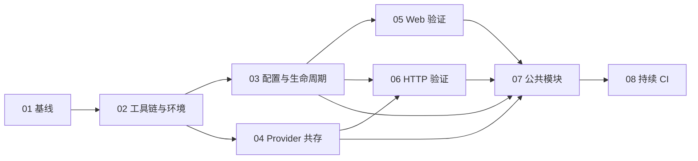

# 方案三执行索引

这是 `.scratch/scheme3-migration/` 当前唯一有效的 ticket 图。方案正文在[方案三开发入口](../../docs/migration/scheme3/README.md)，规格在 [spec.md](spec.md)，稳定验收 ID 与首责票在[验收责任表](../../docs/migration/scheme3/acceptance-matrix.md#ticket-ownership)。只读取本目录直属 `issues/` 下的票构建执行图；`history/` 和复核报告用于追溯。

## 执行规则

1. 先完成 **#01**，再完成 **#02**。
2. **#03–#06 是四项前置验证**：配置/生命周期、Provider/SPI 共存、Web/Jakarta、认证/HTTP 幂等。四项必须有通过证据，才可开始 **#07** 的公共模块批量迁移。
3. 每票只在其 `Blocked by` 全部有通过证据时领取；同一层可并行。`ready-for-agent` 表示票的合同完整，不表示 blocker 已完成。
4. 每票开始前读取 spec、本票 `Contract` 指向的验收 ID、blocker 的产物和对应方案章节。首责票提交可重放命令、fixture、版本、报告和失败诊断；复验票只消费已有证据并补充自身场景。
5. #02 建立的影子 reactor 按后续模块票扩展；#08 从已迁入范围开始持续执行构建/依赖/许可证闸门。#23 才切换根入口并删除活跃 Tycho/P2/OSGi 路径。
6. 所有 Docker 命令使用 `sudo`。成功、失败和中断都清理本轮创建的容器、网络和临时资源，并保留脱敏日志。
7. 不可用的生产 endpoint 或跳过的必需操作不算通过。旧版性能阈值不是方案三验收标准；#20 交付迁移版重复运行画像，不作跨版本回归结论。实现需要改变外部合同时，先更新方案、验收矩阵和本票，再继续代码。
8. 宽范围的机械迁移按票执行 expand–contract：只将当前票负责的模块加入新 reactor，保持已有验证通过；若某一批不能独立通过，先拆出最小适配或共用集成分支并明确最终验证票，不把未完成迁移隐含交给下一票。

## 当前任务与依赖

| Ticket | Title | Blocked by | Acceptance ownership |
|---:|---|---|---|
| 01 | [冻结旧版行为、性能基线与回退制品](issues/01-freeze-baseline.md) | None | BASE-01, PERF-01 |
| 02 | [建立最小 Java 21 影子构建与 Docker/MinIO 环境](issues/02-java21-shadow-harness.md) | 01 | BUILD-01, ENV-01 |
| 03 | [验证统一 YAML、配置转换与最小启停链路](issues/03-config-lifecycle-spike.md) | 02 | GATE-CFG |
| 04 | [验证全部 factory 的 SPI 生命周期与 SDK 共存](issues/04-provider-coexistence-spike.md) | 02 | GATE-SPI |
| 05 | [验证代表性页面和 multipart 在 Boot/Jakarta 可用](issues/05-web-jakarta-spike.md) | 03 | GATE-WEB |
| 06 | [验证带服务认证、重试和幂等的 Driver HTTP 链路](issues/06-authenticated-http-spike.md) | 03, 04 | GATE-HTTP |
| 07 | [按已验证合同迁移公共模块](issues/07-shared-module-migration.md) | 03, 04, 05, 06 | CORE-01 |
| 08 | [将构建与依赖审计接入持续 CI](issues/08-continuous-build-gates.md) | 07 | CI-01 |
| 09 | [交付 Controller Boot 进程和生命周期](issues/09-controller-boot.md) | 08 | APP-C |
| 10 | [交付 Driver Boot 与完整本地 Mock mission 链路](issues/10-driver-boot-mock-registry.md) | 08 | APP-D |
| 11 | [交付 sio、siov1、gdas 生产 Provider](issues/11-sineio-provider-migration.md) | 10 | PROV-SIO |
| 12 | [交付旧 SDK 的 S3 生产 Provider](issues/12-s3-provider-migration.md) | 10 | PROV-S3 |
| 13 | [交付八条 Driver HTTP 命令与服务认证幂等](issues/13-driver-http-contract.md) | 10 | HTTP-D |
| 14 | [交付长时间 workload 的可靠跨进程调用](issues/14-controller-http-client.md) | 09, 13 | HTTP-C |
| 15 | [迁移 Controller 页面操作与既有 CLI](issues/15-controller-web-actions.md) | 14 | WEB-C1 |
| 16 | [迁移 Controller 导出、指标与 Web 边界行为](issues/16-controller-web-observability.md) | 15 | WEB-C2 |
| 17 | [迁移 Driver 页面与命令共存](issues/17-driver-web.md) | 13 | WEB-D |
| 18 | [完成配置转换、正式命令与多 Driver 运维](issues/18-config-operator-commands.md) | 14 | OPS-01 |
| 19 | [完成部署组合与全部 Provider 端到端回归](issues/19-deployment-integration.md) | 11, 12, 16, 17, 18 | INT-01 |
| 20 | [执行三次同参数性能与资源画像](issues/20-performance-regression.md) | 19 | PERF-02 |
| 21 | [生成独立生产归档与 Java 21 镜像](issues/21-production-package.md) | 11, 12, 16, 17, 18 | PKG-01 |
| 22 | [验收实际生产制品、旧数据与回退](issues/22-release-rollback-validation.md) | 20, 21 | REL-01 |
| 23 | [切换根构建并完成 OSGi 收缩复验](issues/23-finalize-remove-osgi.md) | 22 | FINAL-01 |

截至 2026-11-10，#20–#22 状态为 `completed`；#01–#19 与 #23 共 20 张票为 `ready-for-human`。#19 已有完整集成通过证据。按本仓库标签定义，`ready-for-human` 表示该票需要人工实施，不代表已完成或只待复核；#01 和 #23 仍有依赖真实 endpoint/凭据、历史配置或数据的验收项未补。其他票的未关闭验收项按验收责任表由首责票处理。

## 旧票映射

修订前 15 张票已保存在[历史快照](history/2026-10-28-before-revision/README.md)，不属于当前执行图。旧票映射如下：

| 旧票 | 当前票 |
|---:|---|
| 01 baseline | 01 |
| 02 Maven shadow reactor | 02, 07, 08 |
| 03 common modules/SPI | 07 |
| 04 Controller boot | 09 |
| 05 Driver boot | 10 |
| 06 Provider registry/Mock | 04, 10 |
| 07 SineIO/S3 | 11, 12 |
| 08 Driver HTTP contract | 06, 13 |
| 09 Controller HTTP client | 14 |
| 10 Controller Web | 05, 15, 16 |
| 11 Driver Web | 17 |
| 12 config/start/stop | 03, 18 |
| 13 Docker/MinIO/CI | 02, 08, 19, 20 |
| 14 production package/rollback | 21, 22 |
| 15 remove OSGi/finalize | 23 |

## 前置验证的依赖关系

每个 blocker 的通过证据是下一张票的输入：

#05 Web spike 在 #03 后启动；#06 使用 #03/#04 的合同。#09/#10、#11/#12/#13、#15/#16/#17/#18 等后续边界以表格为准，不按旧票的线性顺序强制串行。
