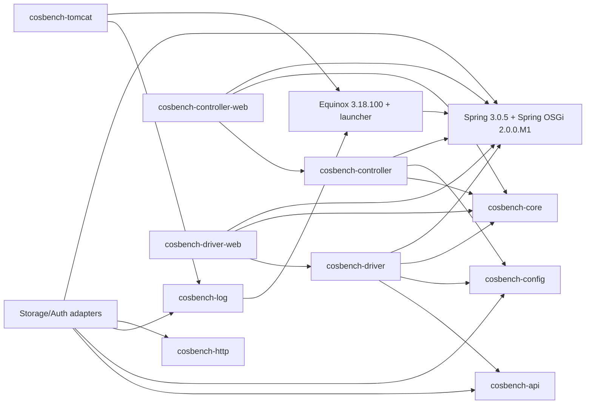

# Bundle inventory and dependency graph — Phase 0

## Inventory rules

**已确认：** 32 个 MANIFEST（`dev/*` 30 个、`ext/adaptor/*` 2 个），全部有 `Bundle-SymbolicName`、`Bundle-Version` 和 `Bundle-RequiredExecutionEnvironment`；除扩展 `abc-*` 为 JavaSE-1.6，其余为 JavaSE-1.8。未搜索到 `DynamicImport-Package`。版本大多为 `0.6.0.1`，两个 ext bundle 为 `0.3.1.0`。行号均指对应 MANIFEST 的字段起始行；折行值沿续到下一个字段。

## Bundle 清单表

| Bundle / MANIFEST | SymbolicName；version；执行环境 | Activator / Fragment / Require | Export（已确认） | Import（已确认，按首要包归纳） | build.properties / 迁移候选 |
|---|---|---|---|---|---|
| `dev/cosbench-api/META-INF/MANIFEST.MF:4-14` | `cosbench-api`; 0.6.0.1; JavaSE-1.8 | — | `api.auth`, `api.storage`, `api.context` | `config`, `log` | `src→bin`, `META-INF`; `cosbench-api` |
| `dev/cosbench-config/META-INF/MANIFEST.MF:4-15` | `cosbench-config`; 0.6.0.1; JavaSE-1.8 | — | `config` | `log`, Commons Configuration/Lang, Castor | `src→bin`; `cosbench-config` |
| `dev/cosbench-core/META-INF/MANIFEST.MF:4-19` | `cosbench-core`; 0.6.0.1; JavaSE-1.8 | — | `bench`, model/protocol/service/utils | `config`, common/log, Commons CSV/IO/Lang | `src→bin`; `cosbench-core` |
| `dev/cosbench-core-web/META-INF/MANIFEST.MF:4-15` | `cosbench-core-web`; 0.6.0.1; JavaSE-1.8 | — | `web` | Servlet 2.5, Spring MVC 3.0.5, core | `src→bin`; `cosbench-core-web` |
| `dev/cosbench-controller/META-INF/MANIFEST.MF:4-31` | `cosbench-controller`; 0.6.0.1; JavaSE-1.8 | — | `controller.exporter`（其余 controller API 包随字段折行） | bench/http/config/Castor/log/model/protocol/service/utils, Commons CSV/Lang/HttpClient/Jackson1 | `src→bin`; `cosbench-controller` |
| `dev/cosbench-controller-web/META-INF/MANIFEST.MF:4-22` | `cosbench-controller-web`; 0.6.0.1; JavaSE-1.8 | — | — | controller, core/core-web, Servlet 2.5, Spring 3 + Spring OSGi web | `src→bin`; `cosbench-controller-web` |
| `dev/cosbench-driver/META-INF/MANIFEST.MF:4-22` | `cosbench-driver`; 0.6.0.1; JavaSE-1.8 | — | — | api/auth/context/storage, bench, config, log/model/service/utils, Commons IO/Lang | `src→bin`; `cosbench-driver` |
| `dev/cosbench-driver-web/META-INF/MANIFEST.MF:4-21` | `cosbench-driver-web`; 0.6.0.1; JavaSE-1.8 | — | — | bench/core/web/model, Servlet 2.5, Spring 3 + Spring OSGi web | `src→bin`; `cosbench-driver-web` |
| `dev/cosbench-log/META-INF/MANIFEST.MF:4-16` | `cosbench-log`; 0.6.0.1; JavaSE-1.8 | `Bundle-Activator: com.intel.cosbench.log.osgi.Activator:7` | `log` | Commons IO, Log4j 1.2, SLF4J helper, `org.osgi.framework` | `src→bin`; `cosbench-log` |
| `dev/cosbench-tomcat/META-INF/MANIFEST.MF:4-18` | `cosbench-tomcat`; 0.6.0.1; JavaSE-1.8 | `Bundle-Activator: com.intel.cosbench.tomcat.osgi.Activator:6` | — | Catalina, Commons Lang/Log, `org.osgi.framework`, log | `src→bin`; `cosbench-tomcat` |
| `dev/cosbench-http/META-INF/MANIFEST.MF:4-15` | `cosbench-http`; 0.6.0.1; JavaSE-1.8 | — | `client.http` | Apache HttpClient 4.1.x, Commons Codec/Lang | `src→bin`; `cosbench-http` |
| `dev/cosbench-httpauth/META-INF/MANIFEST.MF:4-36` | `cosbench-httpauth`; 0.6.0.1; JavaSE-1.8 | `Require-Bundle: org.apache.httpcomponents.httpclient:35` | — | auth/api/http/config/log, HttpClient | `src→bin`; `cosbench-httpauth` |
| `dev/cosbench-castor/META-INF/MANIFEST.MF:4-10` | `cosbench-castor`; 0.6.0.1; JavaSE-1.8 | `Fragment-Host: com.springsource.org.castor [1.2.0,2.0.0):8` | — | config | 仅 `bin.includes=META-INF/`; `castor` fragment/resource |
| `dev/cosbench-log4j/META-INF/MANIFEST.MF:4-9` | `cosbench-log4j`; 0.6.0.1; JavaSE-1.8 | `Fragment-Host: com.springsource.org.apache.log4j [1.0.0,2.0.0):8` | — | — | 仅 `bin.includes=META-INF/`; Log4j fragment |
| `dev/cosbench-cdmi-util/META-INF/MANIFEST.MF:4-13` | `cosbench-cdmi-util`; 0.6.0.1; JavaSE-1.8 | — | `client.cdmi.util:9` | log | `src→bin`; `cosbench-cdmi-util` |
| `dev/cosbench-ampli/META-INF/MANIFEST.MF:4-14` | `cosbench-ampli`; 0.6.0.1; JavaSE-1.8 | — | — | API/context/storage, config/log, client/http, Amplistor SDK | `src→bin`; `cosbench-ampli` |
| `dev/cosbench-cdmi-base/META-INF/MANIFEST.MF:4-16` | `cosbench-cdmi-base`; 0.6.0.1; JavaSE-1.8 | — | — | API/auth/context/storage, cdmi-util, config/log, HTTP | `src→bin`; `cosbench-cdmi-base` |
| `dev/cosbench-cdmi-swift/META-INF/MANIFEST.MF:4-16` | `cosbench-cdmi-swift`; 0.6.0.1; JavaSE-1.8 | — | — | API/auth/context/storage, cdmi-util, config/log | `src→bin`; `cosbench-cdmi-swift` |
| `dev/cosbench-ecs/META-INF/MANIFEST.MF:4-32` | `cosbench-ecs`; 0.6.0.1; JavaSE-1.8 | — | — | API/auth/context/storage, config/log | `src→bin`; embedded SDK classpath `:14-29`; `cosbench-ecs` |
| `dev/cosbench-gcs/META-INF/MANIFEST.MF:4-27` | `cosbench-gcs`; 0.6.0.1; JavaSE-1.8 | — | — | API/auth/context/storage, config/log | `src→bin`; embedded Google/HTTP/Jackson classpath `:25+`; `cosbench-gcs` |
| `dev/cosbench-librados/META-INF/MANIFEST.MF:4-16` | `cosbench-librados`; 0.6.0.1; JavaSE-1.8 | — | — | API/auth/context/storage, config/log | `src→bin`; embedded `rados.jar`, JNA 3.5.2 `:9+`; `cosbench-librados` |
| `dev/cosbench-openio/META-INF/MANIFEST.MF:4-29` | `cosbench-openio`; 0.6.0.1; JavaSE-1.8 | — | `api.openio:25-29` | API/auth/context/storage, config/log | `src→bin`; embedded Gson/OpenIO API `:25+`; `cosbench-openio` |
| `dev/cosbench-oss/META-INF/MANIFEST.MF:4-24` | `cosbench-oss`; 0.6.0.1; JavaSE-1.8 | — | — | API/auth/context/storage, config/log | `src→bin`; embedded Aliyun/HTTP/JDOM `:9+`; `cosbench-oss` |
| `dev/cosbench-s3/META-INF/MANIFEST.MF:4-31` | `cosbench-s3`; 0.6.0.1; JavaSE-1.8 | — | — | API/auth/context/storage, client/http, config/log | `src→bin`; embedded AWS SDK v1.10.76/HTTP/Jackson/AspectJ `:9-31`; `cosbench-s3` |
| `dev/cosbench-scality/META-INF/MANIFEST.MF:4-16` | `cosbench-scality`; 0.6.0.1; JavaSE-1.8 | — | — | API/auth/context/storage, config/log, HTTP | `src→bin`; `cosbench-scality` |
| `dev/cosbench-sineio/META-INF/MANIFEST.MF:4-100+` | `cosbench-sineio`; 0.6.0.1; JavaSE-1.8 | — | — | API/auth/context/storage, client/http, config/log | `src→bin`; very large embedded Bundle-ClassPath: HttpClient 4.5.13, Log4j 2.23.1 bridge, SLF4J 2.0.9, AWS SDK v2 2.26.8 and v1 1.12.767, Netty 4.1.108:15+; `cosbench-sineio` |
| `dev/cosbench-swift/META-INF/MANIFEST.MF:4-16` | `cosbench-swift`; 0.6.0.1; JavaSE-1.8 | — | — | API/auth/context/storage, config/log, HTTP | `src→bin`; `cosbench-swift` |
| `dev/cosbench-mock/META-INF/MANIFEST.MF:4-16` | `cosbench-mock`; 0.6.0.1; JavaSE-1.8 | — | — | API auth/context/storage, config/log | `src→bin`; `cosbench-mock` |
| `dev/cosbench-keystone/META-INF/MANIFEST.MF:4-16` | `cosbench-keystone`; 0.6.0.1; JavaSE-1.8 | — | — | API/auth/context, config/log, HTTP | `src→bin`; `cosbench-keystone` |
| `dev/cosbench-swauth/META-INF/MANIFEST.MF:4-15` | `cosbench-swauth`; 0.6.0.1; JavaSE-1.8 | — | — | API/auth/context, config/log, HTTP | `src→bin`; `cosbench-swauth` |
| `ext/adaptor/abc-auth/META-INF/MANIFEST.MF:4-15` | `cosbench-abcauth`; 0.3.1.0; JavaSE-1.6 | — | — | API/auth/context, config/log, HTTP | `src→bin`; ext candidate `cosbench-abcauth` |
| `ext/adaptor/abc-stor/META-INF/MANIFEST.MF:4-15` | `cosbench-abcstor`; 0.3.1.0; JavaSE-1.6 | — | — | API/auth/context/storage, config/log, HTTP | `src→bin`; ext candidate `cosbench-abcstor` |
| `dev/cosbench-manta/pom.xml:8,57-95,157-181`（无 repo MANIFEST） | Maven bundle `cosbench-manta`; 1.0.2-SNAPSHOT；Java min 1.8 | Maven Bundle Activator `com.joyent.manta.cosbench.Activator:170` | Private config package | provided CosBench 0.4.1.0 API/config/log；Manta client 2.0.0、SLF4J 1.7.7；OSGi R4 optional | `build.properties:1-3` 仍为 `src→bin`，与 Maven `src/main/java` 不一致；候选需单独处理 |

**字段完整性说明：** 每个上表 manifest 均逐个读取；未列 `DynamicImport-Package` 表示该字段未出现，不是运行时禁止动态导入。长 `Import-Package`/`Bundle-ClassPath` 采用“首要包/字段起始行”摘要，原始折行值仍在对应文件中。

## 依赖有向图（Manifest + Spring service）

**服务边界：** adapter XML 导出 `StorageAPIFactory`/`AuthAPIFactory`，Driver XML 收集列表并导出 `DriverService`；Controller XML 导出 `ControllerService`。这部分是 Spring OSGi 图上的动态边，不能仅凭 Java import 替代。

## 环依赖清单

- **已确认：** 直接 MANIFEST package/import 图未发现可由 headers 单独证明的闭环；`cosbench-httpauth` 有唯一显式 `Require-Bundle`（`META-INF/MANIFEST.MF:35`）。
- **推断：** Controller/Driver web 的 OSGi reference 与 core service 的导出构成运行时服务闭环（不是静态包环），启动顺序失败会表现为 bean 未满足。
- **待验证：** 多个 adapter 共存时 Spring OSGi service list 的排序与重复类型行为；需 Equinox console `ss/services` 和启动日志确认。

## 不能直接迁移的资源/规则

1. `cosbench-castor`、`cosbench-log4j` 是 fragment，不是普通 Java module；必须保留 host wiring 语义。
2. ECS/GCS/Librados/OpenIO/OSS/S3/SineIO 的 `Bundle-ClassPath` 嵌入 JAR 不能仅用普通 Maven provided 依赖替换；需要逐项类路径与许可证复核。
3. `META-INF/spring/plugin-context.xml`、`WEB-INF/spring/*-osgi-context.xml`、`WEB-INF/web.xml` 依赖 Spring OSGi namespace/web context；需先建立等价服务发现测试。
4. `dev/cosbench-manta` 同时有 Maven bundle、Eclipse build.properties、`build-dependencies` 本地仓库；不能按普通 `dev/*` PDE 模块处理。
5. `release/conf/.controller/config.ini`/`.driver/config.ini` 中的 start-level、bundle 路径和 `osgi.framework` 版本是发行包的一部分。
