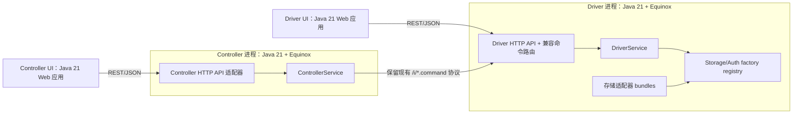
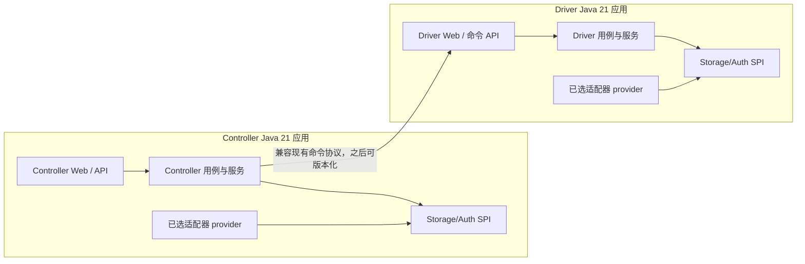
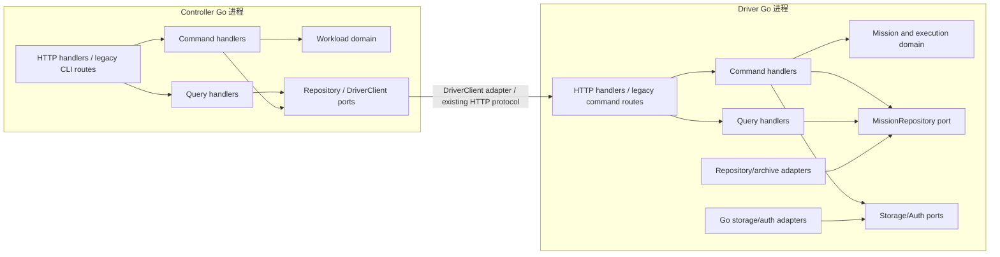

# COSBench 运行栈现代化改造方案

状态：设计建议，尚未开始实施。本文对比三条路径：保留 OSGi 内核并拆分 Web（方案二）、从新构建和发行版移除 OSGi（方案三），以及使用 Go 重构整个运行栈（方案四）。Java 路径以 Java 21 runtime 为基线；Go 路径在实施时选择受支持的 Go 稳定版本。依赖版本应按厂商支持矩阵锁定，不在本文中固定具体小版本。

公开项目实际采用的 Spring DM 迁移路径、官方原因与证据，另见 [Spring DM 项目与产品迁移案例调研](spring-dm-migration-cases.md)。该调研区分历史兼容迁移与当前运行栈支持，不能用历史案例代替本项目的 Java 21 验证。

方案二的文件级范围仍见[迁移改造范围估算](scheme3/scope-estimate.md)中的方案二章节。方案三的完整开发资料已集中到 [方案三开发入口](scheme3/README.md)，包括详细实施路径、模块盘点、验收矩阵、待决策项、开发规格和范围估算。

## 1. 当前结构与改造目标

当前项目是由 Tycho 构建的 OSGi 多 bundle 系统。根 `pom.xml` 使用 Tycho 1.7.0；多数 bundle 的 `Bundle-RequiredExecutionEnvironment` 为 `JavaSE-1.8`。Controller 和 Driver 各自启动 Equinox，并从 `release/conf/.controller/config.ini`、`release/conf/.driver/config.ini` 装配运行时。

当前运行栈包括 Equinox bundle `3.18.100.v20220817-1601`、Tomcat 6.0.16、Spring Framework 3.0.5 和 Spring Dynamic Modules 2.0.0.M1。Controller/Driver Web bundle 通过 `OsgiBundleXmlWebApplicationContext` 运行；Spring DM 还负责发布和查找 `ControllerService`、`DriverService`、`StorageAPIFactory`、`AuthAPIFactory` 等 OSGi 服务。代表性配置见：

- `release/conf/.driver/config.ini`
- `dev/cosbench-tomcat/META-INF/MANIFEST.MF`
- `dev/cosbench-controller-web/WEB-INF/web.xml`
- `dev/cosbench-controller/META-INF/spring/controller-osgi-context.xml`
- `dev/cosbench-driver/META-INF/spring/driver-osgi-context.xml`
- 各适配器的 `META-INF/spring/plugin-context.xml`

三条路径均以以下目标为准：

1. 方案二/三以受支持的 Java 21 运行 Controller 和 Driver，并把构建 JDK 与源码/字节码目标分开管理；方案四交付受支持 Go 版本构建的独立 binary，不依赖 JVM。
2. 选定路径后移除 Spring DM、Tomcat 6 及其启动绑定；Java 路径逐项验证 Spring、Jackson、Log4j 和 SDK 兼容性，Go 路径逐个替换对应实现与 SDK。
3. 保持 workload XML、CLI、Controller 到 Driver 的命令协议、Web 路由、身份认证、日志/配置下载、Prometheus 指标和各存储适配器行为可验证。
4. 不跨进程传输现有 Java 内部对象；任何新远程接口都使用版本化 DTO 和明确的错误语义。

## 2. 三条方案的结构差异

### 方案二：OSGi 引擎 + 独立 Java 21 Web 应用

Controller 和 Driver 仍分别以 Equinox 进程运行，存储适配器仍是独立 bundle。Spring DM 服务装配改为 OSGi Declarative Services（DS）。Controller/Driver 引擎通过一个轻量 HTTP API 适配器向 UI 暴露版本化 DTO；独立的 Controller UI 和 Driver UI 进程以 Java 21 运行，调用这些 HTTP 接口。Web 应用不能直接依赖 `ControllerService`、`DriverService` 的 Java 类型，因为跨进程后它们不再是共享对象。



Web 应用可以使用独立的现代 Spring Web 运行栈，部署在本机或独立主机。引擎侧 API 适配器应与 Servlet API 解耦，避免把 Jakarta/`javax` Servlet 类带进 OSGi 服务契约。若采用 OSGi HTTP Whiteboard，则先验证实现、Servlet 命名空间、Java 21 和 Equinox 的组合；若该组合引入额外版本冲突，可把 API adapter 设计为独立 HTTP server bundle。具体 HTTP server 实现应在技术验证阶段锁定。

方案二保留动态安装/卸载 bundle 和 bundle 级类加载隔离。它只把 Web 前端移出 OSGi；如果后续要移除 OSGi，方案二的 HTTP DTO 契约可作为方案三的稳定边缘接口。

### 方案三：普通 Java 模块 + Spring Boot 3 应用，移除新发行版中的 OSGi

Controller 和 Driver 使用两个 Spring Boot 3 app；业务模块通过普通 Spring DI 装配，继续复用可迁移的 XML Bean、FreeMarker 模板和静态资源。Controller/Driver 页面随 app 迁移，保留页面结构、URL、表单、路由、view name 和输出合同，只改 Java Web backend、Spring wiring、Servlet namespace 和容器配置。Web 与业务在同一进程调用本地 service，不需要新的 UI REST DTO。Controller 到 Driver 的 HTTP 命令链路保持兼容。新发行版正式支持 SineIO（`sio`、`siov1`、`gdas`）和旧 S3（`s3`）；Mock 只用于测试。其余 Provider、Manta、ext 和旧 Tomcat 源码与 OSGi metadata 保留在 `legacy/osgi/`，不参加新构建/发行，旧版归档是它们唯一可运行的支持。活跃源码使用标准 Maven 目录，新配置为 YAML，通过新命令启动/停止；Provider 由应用启动时的静态 `ServiceLoader` 发现。



该方案的新构建和发行包移除 Equinox/Tycho、活跃模块的 OSGi manifest、bundle activator、Spring DM 和旧 Tomcat 集成。Controller/Driver Web backend 仍属于活跃迁移范围，但页面模板与静态资源直接复用。`legacy/osgi/` 明确保留原 Provider 源码和 OSGi metadata，但不会由新 reactor 构建或由新版本承诺运行。新发行版不支持 Provider 热安装/卸载；新增/删除 Provider 需要重新打包和重启。SineIO/S3 依赖先验证是否可共享 classpath，只有确认有冲突后才增加静态启动时隔离。

### 方案四：Go 全量重构

Controller、Driver、Web/API 和存储适配器都改为 Go 实现，最终发行包不再需要 JVM、Equinox 或 Java bundle。采用两个独立进程和可执行文件：`cosbench-controller`、`cosbench-driver`。Controller 到 Driver 的既有 HTTP 命令协议先保持兼容，便于 Java/Go 组件混跑和逐步切换。所有 Java storage/auth adaptor 都必须以 Go 重写或明确退出支持范围；Go 无法直接加载现有 Java SDK 或 OSGi bundle。



Go 代码按仓库约定使用 DDD Lite、CQRS、Clean Architecture 和 DIP，保持实用边界，避免把简单功能拆成大量空壳 package：

- **DDD Lite：** Controller 侧以 Workload/Workflow 为核心模型，Driver 侧以 Mission/Stage/Worker 生命周期为核心模型，显式实现状态转换和不变量。不引入 event sourcing，也不把每个 operation 都做成 aggregate。
- **CQRS：** 提交、取消、启动、关闭等写操作使用独立 command handler；查询 workload、mission、worker、metrics 使用 query handler 和面向展示的 read model。第一阶段仍使用现有内存仓库和文件归档，不要求引入独立读写数据库。
- **Clean Architecture：** domain 与 application 不依赖 `net/http`、对象存储 SDK、文件系统实现或 Docker。HTTP、配置文件、日志、Driver HTTP client、存储 SDK 和归档格式属于外层 adapter。
- **DIP：** 由 application/use case 定义所需 ports，例如 `WorkloadRepository`、`DriverClient`、`Storage`、`AuthProvider`、`ArchiveWriter`、`Clock`；外层 adapter 实现这些接口，由 `cmd/.../main.go` 作为 composition root 装配。

建议的 Go 模块布局如下，名称可按迁移时的仓库结构调整：

```text
cmd/cosbench-controller/       # Controller 进程组合根
cmd/cosbench-driver/            # Driver 进程组合根
internal/controller/domain/     # Workload、Workflow、状态和领域规则
internal/controller/application/command/
internal/controller/application/query/
internal/controller/application/port/
internal/controller/adapter/in/http/
internal/controller/adapter/out/driverhttp/
internal/controller/adapter/out/archive/
internal/driver/domain/         # Mission、Stage、Worker 生命周期
internal/driver/application/command/
internal/driver/application/query/
internal/driver/application/port/
internal/driver/adapter/in/http/
internal/driver/adapter/out/storage/
internal/driver/adapter/out/auth/
internal/config/                # legacy XML/.conf 解析与新配置
```

Controller Workload use case 通过 `DriverClient` port 派发任务；Driver use case 通过 `Storage`、`AuthProvider` ports 调用云存储。接口由使用方 package 拥有，两个 bounded context 共享的内容限制在稳定的小型 wire DTO/协议包；不能让 Controller 直接依赖 Driver 的 domain model，也不能由 `internal/shared` 汇集所有业务类型。

此方案不只是 JVM 替换。Driver 的并发执行、流式数据处理、随机对象选择、操作计数、吞吐和延迟直方图都位于 benchmark 热路径，必须先定义行为基线，再评估 Go 实现。适配器和 benchmark 结果通过逐阶段兼容验证；不能以“Go goroutine 数更多”推断吞吐必然提高。

## 3. 关键模块和接口

| 当前代码/配置 | 方案二 | 方案三 | 方案四：Go |
|---|---|---|---|
| `dev/cosbench-core` 的 `ControllerService`、`DriverService` | 保留为 Equinox 内部服务；HTTP adapter 映射到 DTO | 普通 Java 接口，由应用组合根直接注入 | 映射为 Controller/Driver application use case ports；定义版本化 JSON wire DTO |
| `dev/cosbench-api` 的 `StorageAPIFactory`、`AuthAPIFactory` | 保留 SPI，由 DS 发布和聚合 | 保留 Java SPI；新包静态发现 SineIO/S3，Mock 仅 test profile；其他 Provider 留在 `legacy/osgi/` | 重写为 Go ports 和明确 adapter registry；Java JAR 不可复用 |
| Controller/Driver `META-INF/spring/*osgi-context.xml` | 转为 DS 组件和引用；迁移服务发布/多服务注入 | 删除；改由 Java/Spring 配置装配 | 删除；命令/查询 handler 和 domain 由 Go composition root 装配 |
| 各适配器 `META-INF/spring/plugin-context.xml` | 转为 DS component descriptors | SineIO/S3 声明 production SPI，Mock 仅测试；其余源码/metadata 保留在 `legacy/osgi/` | 各存储/auth provider 以 Go adapter 实现并注册；能力逐项核对 |
| `dev/cosbench-controller` | 保留 OSGi bundle 和 Controller 逻辑 | 转普通 Java 模块和应用 | 重写为 Workload/Workflow domain、commands/queries、repository 和调度 adapters |
| `dev/cosbench-driver` | 保留 bundle；逐步改 DS | 转普通 Java 模块和应用 | 重写 Mission/Worker 执行与操作热路径；需要专项性能验收 |
| Controller/Driver Web | 页面迁到独立 Java Web 应用，通过 HTTP DTO 访问引擎 | 两侧页面后端留在各自普通 Maven Web 模块，由对应 Boot app 同进程装配；保留 FreeMarker、静态资源、路由和表单，仅改 Java Web backend、Spring wiring 与 Servlet namespace | 用 Go `net/http` / HTML 模板或独立静态 UI 调用 Go API；复刻现有路由和表单行为 |
| `dev/cosbench-tomcat`、Tomcat 6 | 移除 OSGi Tomcat；引擎 API adapter 承担协议入口，UI 用独立容器 | 旧源码留在 `legacy/osgi/runtime/`；两个 Boot app 使用 embedded server | 删除；Go HTTP server 实现 UI/API 及过渡期 wire protocol |
| `dev/cosbench-log` OSGi activator | Equinox 下可暂留，之后迁普通初始化 | 移除 activator，统一现代日志配置 | 替换为 Go `log/slog` 或统一 logger port 的 adapter |
| `dev/cosbench-manta` 独立构建和 activator | 保留 bundle，验证 DS/Java 21 | 源码与 metadata 留在 `legacy/osgi/providers/`；旧归档是唯一可运行支持 | 单独验证 Go SDK/协议可用性；无法保持 parity 时明确降级或退役 |
| `release/conf/*`、Tomcat XML | 更新 bundle/start level 和 API 配置 | 改应用配置、启动参数和服务脚本 | 提供 legacy config 导入器，之后迁移到 Go 配置；保留端口、路径和权限语义 |
| 根 `pom.xml` / Tycho 1.7.0 | Tycho 仍构建 OSGi；新 UI 独立 Maven build | 活跃模块构成普通 Maven reactor；legacy OSGi 源码不进入该 reactor 或新发行包 | Go module 构建两个 binary；移除 Tycho、P2、PDE 与 JVM 发行依赖 |

## 4. 方案二实施步骤

### 2.0 建立迁移基线

1. 以当前可发布版本建立归档基线，记录 Controller、Driver、Web、适配器矩阵、workload 样本、配置目录、端口和启动参数。
2. 建立现有行为的黑盒契约测试：页面主要流程、Controller CLI 路径、Driver 命令请求/响应、下载内容、Prometheus 输出和认证行为。
3. 清点外部调用者。重点查明谁依赖 Controller `/cli/*.action`、Controller 的 `*.do` 路由以及 Driver `/i/*.command`。不能从代码仓库推断部署环境中的全部调用方。
4. 先在当前 Equinox 运行时验证 Java 21 启动、bundle resolve、线程/文件/网络行为和实际 benchmark workload。单纯 JVM 启动成功不作为兼容性结论。

**出口条件：** 有可重复的基线命令、代表性 workload、功能检查清单和完整依赖/调用方清单。

### 2.1 定义 Controller/Driver HTTP 契约

新增版本化接口，建议以 `/api/v1` 为前缀。路径是设计建议，实施时根据现有 CLI 和自动化调用方决定是否保留旧别名。

| 资源/动作 | 建议接口 | DTO/行为约束 |
|---|---|---|
| Controller 状态 | `GET /api/v1/controller` | 返回 controller 名称、版本、运行状态和能力列表 |
| Workload 提交 | `POST /api/v1/workloads` | 请求体为 workload XML 或明确的上传格式；返回 `202` 和 workload id；支持 request id 避免客户端重试造成重复提交 |
| Workload 查询 | `GET /api/v1/workloads/{id}`、`GET /api/v1/workloads?state=` | 返回稳定的摘要/详情 DTO，不序列化内部 `WorkloadInfo` |
| Workload 操作 | `POST /api/v1/workloads/{id}/fire`、`/cancel`、`/resubmit`、排序命令 | 统一状态码、并发冲突和不存在资源的错误格式 |
| Workload 文件 | `GET /api/v1/workloads/{id}/log`、`/config` | 流式下载，文件名和 content type 固定；路径由服务端解析，不能接受任意文件路径 |
| Controller 指标 | `GET /metrics/prometheus` | 兼容现有指标名称、标签和含义 |
| Driver 状态与任务 | `GET /api/v1/driver`、`GET/POST /api/v1/missions`、`GET /api/v1/missions/{id}` | 包含 mission 摘要、详情和明确状态枚举 |
| Driver 操作 | `POST /api/v1/missions/{id}/login`、`/launch`、`/close`、`/abort` | 返回标准 JSON 错误；操作状态与重复调用语义明确 |

DTO 仅包含 JSON 可表达的标量、枚举、列表和时间；禁止把 `XmlConfig`、`File`、`WorkloadInfo`、`MissionInfo`、Java 异常或 SDK 对象作为网络契约。workload XML 在引擎内解析并校验，错误响应应给出稳定错误码和可读说明。

先保留 Controller 到 Driver 的既有命令协议：`/i/ping.command`、`submit.command`、`login.command`、`launch.command`、`query.command`、`close.command`、`abort.command`、`trigger.command`。兼容层必须保持当前 JSON `Response` 字段、HTTP 状态码和调用语义；等 Controller 与 Driver 同步发布后，再单独讨论协议升级。Controller CLI 的 `/cli/index.action`、`submit.action`、`config.action`、`workload.action`、`cancel.action` 也应保留兼容入口或提供迁移期别名，直到调用方清点完成。

### 2.2 迁移 OSGi 服务装配

1. 先把 `ControllerService`、`DriverService`、`StorageAPIFactory` 和 `AuthAPIFactory` 明确为内部 OSGi 服务接口，保持包名和语义，避免同时改插件行为。
2. 选定 Tycho 支持的 DS 注解处理与运行时实现，验证 Equinox 上的组件发现、服务排序、动态移除和 Java 21。组件声明由构建生成并打包进 bundle。
3. 把 Controller/Driver 的 Spring DM `<osgi:service>`、`<osgi:reference>` 和 `<osgi:list>` 迁为 DS 的服务发布和多重引用。多重 factory 集合要有确定排序规则，不能依赖 bundle 启动顺序。
4. 按适配器逐个替换 `plugin-context.xml` 中的工厂 bean/service 声明。一个插件可能发布多个 storage factory；例如 SineIO 插件不能因为“一 bundle 一 provider”假设而漏掉别名。
5. 增加 OSGi 集成测试，启动真实 Equinox 配置并核对注册表中的 storage/auth 名称、重复项、缺失项和服务移除行为。
6. Spring DM extender 还负责发现并启动普通 `META-INF/spring/*.xml` 上下文，例如 `controller-context.xml`、`driver-context.xml`。迁移时须把其中的 bean 装配、`init-method` 和销毁逻辑移入 DS 组件/生命周期，或由明确的应用组合根管理；不能只删除 `<osgi:...>` 元素。
7. 最后移除 Spring DM extender 和 Spring OSGi schema。Spring Framework 3.0.5 的普通 XML 装配也必须迁到受支持的版本或明确替换，不能因为 `<osgi:...>` 消失就认为 Spring 运行时已现代化。

### 2.3 替换引擎侧 HTTP 服务器

1. 新增独立的 Controller API adapter 和 Driver API adapter bundle；通过 DS 引用 `ControllerService` / `DriverService`，禁止 Web/传输代码直接访问 controller/driver 实现类。
2. adapter 提供 `/api/v1` DTO API 和过渡期兼容路由。Driver adapter 同时保留 `/i/*.command`；Controller adapter 在调用者清点完成前保留 `/cli/*.action`。
3. 设计首选不依赖 Servlet API 的监听器，降低 `javax.servlet` 到 `jakarta.servlet` 的类空间冲突。HTTP server 生命周期由 DS activate/deactivate 管理；线程池、端口、请求体大小、超时和关闭行为均须配置化。
4. 外部 Web 用户请求和引擎内部 API 要分开授权。迁移首期至少限制 API 监听地址/网络范围、校验令牌并使用 HTTPS 代理或等效传输保护；不得把旧表单会话直接当作服务间鉴权。
5. 把错误堆栈、SDK 凭证和本机文件路径从 HTTP 响应中排除；上传 XML 限长，下载日志和配置仅允许按 workload id 访问。

### 2.4 拆分并迁移 UI（方案二）

1. 新建 Controller UI 和 Driver UI Maven 应用，先复制模板、CSS、JS、图片和 favicon，保证主要页面/路由可对照迁移。
2. Controller UI 包含登录、运行/历史/归档 workload 列表、提交/取消/重提、配置向导、matrix workload、stage/timeline、CSV、日志/配置下载和 Prometheus 页面。
3. Driver UI 包含 mission 列表、提交、登录、launch/close/abort、worker 和日志页面。
4. 把现有 Spring MVC `Controller`、`ModelAndView` 类迁为 Web DTO controller/service；如保留 FreeMarker，模板只消费 Web view model。模板不得直接依赖 OSGi 服务或引擎实体。
5. UI app 使用 `HttpControllerClient` / `HttpDriverClient` 实现远程访问；接口旁边保留可替换的 fake client，用于页面和契约测试。
6. 先以新端口部署新 UI，旧 UI 保持可回退；逐个环境切换入口/反向代理，观察错误率和操作结果，再关闭旧 UI bundle。

### 2.5 构建、配置和发布

- OSGi bundle 暂时继续由 Tycho 构建。将 `web/controller-ui`、`web/driver-ui` 放进单独 Maven reactor，避免未经验证就把非 bundle 模块并入 Tycho 根 reactor。
- 增加 API adapter bundle 到两个 `config.ini`，移除 Controller/Driver Web bundle、Tomcat bundle、Spring DM Web extender 和旧 Servlet/Jackson 依赖；按实际 DS 实现更新 Equinox 配置。
- 新 UI 使用独立配置项保存后端 URL、鉴权凭据引用、监听地址和外部 context path。凭据只从环境或受保护配置读取，不提交到仓库。
- 更新 `BUILD-sineio.md`、`BUILD.md`、release 包装脚本和 `ci/docker`：同一 release 中发布引擎与 UI 镜像/归档，附兼容矩阵与升级/回退说明。
- 先保留旧目录结构和旧包作为一个迁移周期的回退制品；确认外部调用方已迁移后再删兼容路由和旧 Web 资源。

### 2.6 方案二验收条件

- Controller 与 Driver 在 Java 21 上从干净配置启动；Equinox 无 unresolved bundle、DS 未满足引用或生命周期泄漏。
- 新 UI 不导入引擎实体包；只通过 DTO 客户端访问 `/api/v1`。
- workload XML 验证、提交、执行、状态查询、取消、重提、历史归档、日志/配置下载和 Prometheus 输出通过回归检查。
- Controller 到 Driver 的 `/i/*.command` 请求/响应与迁移前兼容，既有 CLI `/cli/*.action` 调用方通过契约测试。
- 所有启用的适配器 factory 名称和 capability 与旧版本一致；每种保留的存储至少运行对应 smoke workload。
- UI 用户认证、API 服务认证、上传限制、日志脱敏和网络监听范围经过安全检查。
- 新 UI 切换失败时可恢复旧发行包和配置；workload workspace、archive 和用户配置不需要不可逆数据迁移。

## 5. 方案三实施步骤

### 3.0 范围和行为基线

新发行版支持 Controller、Driver 及两侧 Web backend；Provider 只支持 SineIO 的 `sio`/`siov1`/`gdas` 与旧 S3 的 `s3`。Mock 只用于测试；其他根 Provider、Manta、`ext/adaptor` 和旧 Tomcat 源码与 OSGi metadata 保留在 `legacy/osgi/`，不参加新构建/发行，旧版归档是它们唯一可运行支持。先固定 workload、页面/CLI、`/i` 协议、配置默认值、目录、日志、指标和退出行为。

### 3.1 普通 Maven 构建与目录

1. 新 root reactor 收敛到约 14 个现有活跃模块和两个 app 模块；Mock 只由 test profile 构建，非目标 Provider/Manta/ext/旧 Tomcat 移入 `legacy/osgi/`。
2. 活跃模块使用 `src/main/java`、`src/main/resources` 和 `src/test/java`；保持包名、核心业务边界和模块职责。
3. 用普通 Maven dependency graph 替代活跃模块的 `Require-Bundle`、`Import-Package`、`Export-Package` 和 `Bundle-ClassPath`。SineIO/S3 的依赖先验证共享 classpath，仅在冲突可复现时增加静态启动时隔离。
4. 以 JDK 21 构建和运行；Boot 3 所需的 Java bytecode 下限在实施时根据官方支持要求锁定。

### 3.2 两个应用和 Jakarta Web

1. 新增 `cosbench-controller-app`、`cosbench-driver-app` 两个 Spring Boot 3 executable app，承担 main、配置、日志、组合根、health check 和 shutdown；保留 `ControllerService`/`DriverService` 及 workload/mission 逻辑。
2. 使用 Spring Framework 6/Jakarta；保留可迁移的 Spring XML Bean 和 FreeMarker。将 Web Servlet import、XML schema、context wiring 和容器配置迁到 Jakarta/Boot 3。
3. Controller Web/Driver Web 在各自进程内直接注入 service；保留页面、路由、表单、认证、下载、CSV、Prometheus 和静态资源合同。Controller 到 Driver 的 `/i/*.command` 请求/响应继续兼容。

这里的“Web 迁移”指迁移两个 Web 模块的 Java 后端和运行时装配，不是重写页面：FreeMarker 模板、静态资源、视图名、URL、表单字段和页面结构继续复用；替换的是 OSGi Web context、Spring DM/Tomcat bootstrap、Servlet namespace、filter/session/upload/download 等后端接线。方案三不新增独立 UI 进程，也不引入方案二的 HTTP client/DTO 层。

### 3.3 静态 Provider SPI

1. 用 `ServiceLoader` 在 Driver 启动时发现生产包中的 SineIO 三个 factory 和 S3 factory；不支持运行期热安装/卸载，增删 Provider 需要重新打包和重启。
2. registry 检查 factory 名称、重复、缺失依赖和初始化错误；`COSBStorageAPIService`/`COSBAuthAPIService` 仍只依赖 factory 列表。
3. Mock descriptor 和代码只在 test profile/classpath，用于 registry 和端到端测试，不打入生产包。

### 3.4 新配置、命令和发行物

1. 新配置统一为版本化 `conf/controller.yml`、`conf/driver.yml`；`cosbench-config-migrate` 将旧 INI 转换为新 YAML，报告未知或不能无损映射的字段。
2. 用新的 Controller/Driver/stop 命令启动和停止应用；Docker、CI、打包脚本和构建指南全部改用新入口。
3. 新发行包移除 Equinox、Spring DM、Tycho/P2、旧 Tomcat 6 bundle 和 OSGi 配置；不包含 Mock 或 `legacy/osgi/`。
4. 活跃模块中删除 OSGi metadata；legacy 源码中的 metadata 原样保留且明确不被新 reactor 引用。

### 3.5 验收和回退

- 新构建从干净缓存执行 `mvn clean verify`，不调用 Tycho/P2；新 Docker/发行包不包含 OSGi runtime、Mock 或 legacy Provider。
- Controller/Driver 启停、旧配置转换、Web/CLI/`/i/*.command`、目录/archive、日志、Prometheus 和 SineIO/S3 smoke 与冻结基线一致。
- Mock 流程只在测试构建执行；非目标 Provider 只由对应旧版归档运行。
- 新发行失败时使用旧版完整归档和原配置回退；不对用户 workload/archive 做不可逆迁移。

逐文件模块清单、阶段步骤和验收案例见 [方案三开发入口](scheme3/README.md)。

## 6. 方案四：Go 全量重构步骤

### 4.0 建立行为与适配器清单

1. 以当前发行版为基线，枚举 Controller/Driver 状态转换、workload XML 配置规则、HTTP/CLI 路由、工作目录/CSV 归档格式和退出行为。
2. 从 Driver 配置及仓库适配器目录建立支持矩阵：Mock、S3/SineIO、Swift、OpenIO、Scality、Amplidata、ECS、GCS、OSS、CDMI、Ceph/Librados、Keystone、Swauth、HTTP auth 和独立构建的 Manta。逐个标注当前启用情况、操作支持、SDK/协议、凭证方式、特殊配置项及是否承诺继续支持。
3. 采集 benchmark 基线：固定 workload、对象大小、worker 数、duration/totalOps、目标 endpoint 和硬件；记录每类 operation 的成功/失败数、吞吐、延迟分位数、driver CPU/内存和错误分类。
4. 先保留现有 JSON/HTTP 协议和存档格式作为兼容合同；不要同时改变 URL、workload XML、指标算法和 storage SDK。

**出口条件：** 每个功能都有可执行的 parity check；每个适配器有明确的 Go 迁移、保留 Java 进程或退役结论；有可回放的真实/Mock workload 基线。

### 4.1 建立 Go 组合根和 Clean Architecture 依赖规则

1. 建立一个 Go module 和两个入口 binary：`cmd/cosbench-controller`、`cmd/cosbench-driver`。HTTP server、信号处理、配置读取和生命周期关闭在入口/adapter；业务包不调用 `os.Exit`。
2. 以 Controller、Driver 作为两个 bounded context，各自拥有 domain、application、port 和 adapter package。不要把 `ControllerService`、`DriverService` 的 Java 方法逐个机械复制成一个巨型 Go interface。
3. application 层拥有 consumer-side ports。Controller 至少定义 `WorkloadRepository`、`DriverClient`、`WorkloadArchive`、`Clock`、`IDGenerator`；Driver 至少定义 `MissionRepository`、`Storage`、`AuthProvider`、`Clock`、`IDGenerator`。
4. Domain 只放领域状态、值对象、状态转换、校验和领域规则；XML、HTTP、JSON、文件、日志、TLS 和云 SDK 都留在 adapter。所有依赖从外向内，adapter 实现 application/domain 所需接口。
5. DDD Lite 只在 Workload、Mission 等有状态和生命周期的概念上建立 aggregate/state machine；CQRS 拆开 command 和 query handler，但先共用当前 RAM/file-backed persistence，不为了形式拆成微服务或独立数据库。
6. 增加架构测试或静态检查，阻止 domain/application 导入 `net/http`、厂商 SDK 和 adapter package，阻止 Controller domain 直接导入 Driver domain。

### 4.2 先实现配置与协议兼容层

1. 以 `dev/cosbench-config` 的 `WorkloadResolver`、`MissionResolver`、Castor 映射及 `Config` 语义为输入契约，用 Go XML decoder 重写解析器和 validator。兼容必填项、默认值、元素顺序、属性解析、数值单位、字符串配置语法和错误位置。
2. 保留 `release/conf/config-samples` 中的 workload XML 为 golden fixtures；新增合法、非法、边界和历史样本，比较 Java 与 Go 的解析结果和 validation error。
3. 把 Controller `/cli/*.action` 的文本响应、请求字段、状态码，以及 Driver `/i/*.command` 的 JSON 字段、状态码和异常映射固化成协议测试。至少覆盖公共 `Response` 的 `code`、`succ`、`error`，`SubmitResponse.id`，以及 `QueryResponse.time/version/minVersion/maxVersion/running/report`；同时验证空字段是否省略、content type 和 HTTP 状态码。Go server 逐项实现兼容，不通过 Java class 或内部模型共享 DTO。
4. Controller 到 Driver 的 `submit/ping/login/launch/query/close/abort/trigger` 先维持相同路径和 payload；保留 timeout、重试、身份验证和连接失败语义。
5. 读取现有 `controller.conf`、`driver.conf` 和 Tomcat XML 中仍有用的端口、URL、目录、并发和认证设置；提供导入器/兼容配置，迁移期间不要求用户一次性重写配置。

**出口条件：** Java Controller 可调用 Go Driver，Go Controller 可调用 Java Driver；workload XML golden tests 和旧命令 wire tests 通过。

### 4.3 重写 Driver 和 benchmark 热路径

1. 建立 Mission、Stage、Task、Worker 的生命周期模型，按当前 `MissionState`、`WorkloadState` 和实际转换逻辑明确状态及允许操作；例如 Mission 使用 `SUBMITTED`、`AUTHING`、`AUTHED`、`LAUNCHED`、`FINISHED`、`ACCOMPLISHED` 等状态，并有失败/终止/中止分支。不要把并发执行状态只藏在 HTTP handlers 中。
2. 把 Driver 写操作实现为 command handlers（SubmitMission、LoginMission、LaunchMission、CloseMission、AbortMission、RunTrigger）；把 DriverInfo、MissionInfo、WorkerInfo 和 metrics 查询实现为 query handlers/read models。
3. 将 Java worker/executor 转为有界 goroutine 工作池。`workers` 数量必须直接控制并发；启动/停止通过 `context.Context` 取消，清理函数等待 worker 退出，避免无界 goroutine、泄漏和非确定性 Close。
4. 保持对象数据流式处理：Java `InputStream` 的语义映射到 Go `io.Reader`/`io.ReadCloser`，上传/下载不可为了抽象先把整个对象读进内存。Multipart upload、文件操作、请求取消、timeout、retry 和 storage client 连接池分别验证。
5. 保持 `init/prepare/mprepare/write/mwrite/read/filewrite/mfilewrite/localwrite/restore/head/delete/list/cleanup/dispose` 的执行语义，将各存储操作放在对应 provider adapter，将本地文件写入放在文件 adapter；Controller 的 `delay` 阶段及 `closuredelay` 单独迁移。`none` 是 auth/storage 默认值或 division 配置，不能误建成一种 Driver operation。Go ports 按用例消费者和操作能力切成小接口，避免让不支持 multipart、restore 的 provider 实现无意义的空方法。Provider 的能力和错误分类要映射清楚，不把一个存储不支持的 operation 假装成成功。
6. 重写 per-worker 随机对象名、对象大小生成和 operation ratio 选择。测试中提供可控 seed 便于复现；生产默认随机行为保持兼容。
7. 重写指标聚合与直方图逻辑，明确 `opCount`、失败数、sample count、byte count、worker count、吞吐窗口和 latency 单位。计时使用单调时钟语义；用同一组已记录 samples 验证 Histogram/Aggregator/Report 的确定性输出，再比较实际 workload。现有 `WorkerContext.getSnapshot()` 会推进版本并补偿空窗口，迁到 CQRS 时应由采样器维护快照、兼容层管理旧协议 cursor，查询读取一致的快照副本，避免 UI 轮询改变统计结果。
8. 对 benchmark loop 做 allocation/CPU/heap profile；优化 GC 和 buffer 生命周期时保持背压、并发上限与取消行为。性能目标由 4.0 的同环境基线制定，不预先承诺 Go 一定更快。

### 4.4 逐个迁移 storage/auth provider

1. 第一批建议包含 Mock、S3/SineIO。它们能先验证完整的配置、读写/删除、multipart、认证、错误和计量链路。SineIO 使用 S3 兼容 API 时仍需对自定义 operation、region、path-style、TLS、restore 和并发行为做真实端点测试。
2. 后续按用户实际使用优先级迁移 Swift/Keystone/Swauth、GCS、OSS、OpenIO、Scality、Amplidata、ECS、CDMI、Ceph/Librados 和 Manta。S3 兼容不自动等于完全兼容；每个 endpoint 都要跑功能矩阵。
3. 针对每个 Java adaptor 先定义同一套契约：工厂名、配置键、认证行为、operation 覆盖、streaming、timeout、retry、异常类别、资源关闭和指标。适配器重写后以契约测试验收。
4. Go SDK 只作为候选，不按产品名字推断能力。当前可调查的官方/上游入口包括 AWS SDK for Go v2、Google Cloud Go Storage client、Gophercloud、Aliyun OSS Go SDK、Ceph Go bindings；逐个核实维护状态、服务 API 覆盖、版本支持、CGO/系统依赖和许可证。Manta、特定 CDMI/Amplidata/OpenIO API 若没有合适的 Go 客户端，需要评估自写协议实现或正式退役。
5. 发行版内置 Go adapters 初期采用静态编译/显式 registry。Go 原生插件要求主程序与插件使用相同工具链及一致的依赖和构建条件，平台支持也有限，默认采用静态注册。[Go plugin 官方限制](https://pkg.go.dev/plugin)。若必须支持独立第三方扩展，另行评估进程间 adapter 协议，并量化每次 I/O 多一跳的开销。外部 custom adaptor 作者需要 Go API 和构建指南。
6. 在适配器没有 Go parity 前，可将未迁移的存储继续交给旧 Java Driver 进程运行；Go Controller 经兼容协议调度旧 Java Driver。不能让 Go runtime 直接反射/调用 Java adaptor JAR。

候选 SDK 的官方资料： [AWS SDK for Go v2](https://github.com/aws/aws-sdk-go-v2)、[Google Cloud Go Storage client](https://cloud.google.com/go/docs/reference/cloud.google.com/go/storage/latest)、[Gophercloud](https://github.com/gophercloud/gophercloud)、[Aliyun OSS Go SDK](https://github.com/aliyun/aliyun-oss-go-sdk)、[Ceph Go bindings](https://github.com/ceph/go-ceph)。这些链接只用于启动兼容性审查；不代表已确认 COSBench 所需操作均受支持。

### 4.5 重写 Controller 用例与存档

1. 以 Workload/Workflow 为领域模型，显式实现 submit、fire、cancel、resubmit、change order 等状态转换和并发约束。Controller 的 Scheduler、Tasklet、WorkloadProcessor 经 application use case 调用 `DriverClient` port。
2. 按 CQRS 划分写操作和读模型：Active/History/Archived workload、ControllerInfo、timeline/stage/worker metrics、CSV export 分别定义 query，不让 UI 从 repository 内部集合自行筛选。
3. 先实现等价于现有 `RAMWorkloadRepository`、`SimpleWorkloadArchiver`、CSV snapshot loader 的 Go adapter，保持现有工作目录和可读取的 archive 格式。第一期不要把 CSV 归档改成数据库或新 schema。
4. 将 Controller 页面、Driver 页面、静态资源和 Prometheus endpoint 迁到 Go `net/http` handlers；可以保留静态图片/JS/CSS，FreeMarker 模板迁为 Go HTML templates 或保留为独立 UI。将表单处理、session/role、下载头和错误页纳入回归测试。
5. CLI 和页面继续通过稳定的 application API 调用命令/查询；handler 只做输入解析、校验、调用 use case 和 response mapping，不承载调度或状态规则。

### 4.6 Java/Go 混跑和逐组件切换

1. 先用 Go Driver 替换一个 Java Driver 实例，Controller 暂时保持 Java；通过现有 `/i/*.command` 协议跑 Mock 和第一批已迁移 storage workload。
2. 再把 Go Controller 接入现有 Java Driver fleet，验证 `/cli/*.action`、Controller Web 行为、历史归档和多个 Driver 调度。可按 workload/driver 分批切流。
3. 将已迁移 storage 的 Driver 节点切换到 Go；未迁移的 adaptor 仍由 Java Driver 承载。记录每个节点的实现和 adapter capability，避免同一节点被重复调度。
4. 对每个运行角色保留旧 Java binary、原配置、原 workspace/archive 和端口回退方法。新旧进程不应同时写同一个 archive/workspace；切换时保证单一写入者。
5. 所有支持的 storage/auth adaptor、CLI/UI 和协议均有 Go parity 后，才从发行包移除 Java/Equinox。旧 Java 插件扩展者应获得弃用周期和 Go adaptor 迁移指南。

### 4.7 构建、配置和发行

- 在仓库根增加 Go module、Go test/vet 和二进制构建任务；Java 与 Go 发布链路并行一段时间，明确每个 artifact 的 Controller/Driver/runtime 类型。
- 发布两个独立 binary 或对应容器镜像；以配置决定 role 所需的 HTTP 地址、Driver 节点、工作目录、日志目录、并发、存储凭证和 archive 路径。
- 将 secret 通过环境变量或外部 secret mount 注入；日志过滤 access/secret keys 和 HTTP authorization header。
- 使用 Go 交叉构建/容器发布前核对目标 OS/architecture、TLS root CA、CGO 需求和 native Ceph 等依赖；不支持的目标要显式写进发行矩阵。
- 开发调试和集成验收遵循仓库约定，在 Docker 容器中执行；所有 Docker 命令添加 `sudo`。临时容器使用自动清理配置，结束后清理本次创建的容器和临时网络，不删除用户已有容器或测试数据。Race 检测使用满足目标平台 CGO/工具链要求的测试镜像，与纯 Go 发行镜像分开配置。
- 更新 `BUILD.md`、`BUILD-sineio.md`、Docker workflow、启动/停止脚本和用户指南。提供旧 Java 配置到 Go 配置的迁移工具/说明，以及 Java 与 Go 版本的混跑矩阵。

### 4.8 方案四验收条件

- Controller 与 Driver 两个 Go 进程可独立启动、健康检查、响应 shutdown signal 并清理 goroutine、HTTP server、storage client 和文件句柄。
- XML golden tests、Controller CLI 文本响应、Driver JSON 协议、状态码、下载内容和 Prometheus 指标通过 Java/Go 交叉测试。
- 每个承诺支持的 workload operation 与 storage/auth provider 都通过契约测试和端到端 workload；不能以只有 S3/Mock 通过来宣称全量迁移完成。
- 结果计数、错误类别、对象字节数、吞吐窗口和 latency histogram 与 Java baseline 对齐；性能比较在同硬件和存储端多次运行后确定验收阈值，另记录 p95/p99 和每 operation allocation。
- Controller archive/history 可以从旧版本读取；新旧进程不会并发写同一数据目录；回退演练验证旧 Java release 可恢复运行。
- CI 运行 `go test ./...`、`go vet ./...`；并发状态/生命周期代码运行 `go test -race`；XML/parser 输入运行 fuzz 测试；适配器和公开 wire contract 有集成测试。
- 完整 Go 发行包在声明的 OS/architecture/CGO 组合上构建并通过 Docker/部署 smoke test；清除发行包中的 JRE、Equinox、bundle、Tycho/P2 依赖后仍能完成 benchmark。

## 7. 共用测试计划与发布闸门

| 测试层 | 重点覆盖 | 放行条件 |
|---|---|---|
| 模块/单元测试 | XML 解析、service 状态转换、factory registry、DTO mapping、错误映射 | 核心分支与失败路径有测试，重复 factory/非法配置可诊断 |
| SPI/adapter 契约测试 | 所有已支持的 Auth/Storage factory、多个 provider、SDK 异常 | 名称、能力、配置校验和生命周期与基线一致 |
| Controller/Driver 集成测试 | 提交、查询、fire/launch、cancel/close/abort、历史/归档、网络错误 | 真实 HTTP 和真实存储 mock 通过，Driver 不可达时错误状态符合预期 |
| Web/API 契约测试 | 登录、旧路由、DTO schema、上传、下载、Prometheus、HTTP 状态码 | 兼容路由和公开响应保持约定；禁止泄漏内部类名/堆栈 |
| 端到端 workload | noop/mock、S3、SineIO、Swift 或发行版承诺覆盖的存储 | 比对完成数、错误数、操作计数和报告；性能变化先记录，不以单次波动判定 |
| 打包/运行测试 | 干净机器/容器、Java 21 或 Go binary、启动停止、重启后历史恢复、配置和日志目录 | CI 发行包可复现，stop 不残留进程，回滚步骤演练通过 |

改造阶段中每个迁移批次都必须可独立构建、可启动、可回退。先固定功能正确性，再采集性能基线；性能比较需在相同硬件、对象大小、并发和存储端条件下重复执行。

## 8. 取舍与建议

| 维度 | 方案二：保留 OSGi、拆 Web | 方案三：Java 21 移除 OSGi | 方案四：Go 重构 |
|---|---|---|---|
| 运行时 | Java 21 UI + Equinox 引擎 | Java 21 Controller/Driver/Web | Go Controller/Driver/Web，无 JVM |
| 改造范围 | 中高；需 DTO/HTTP contract、DS 和 UI 解耦 | 高；还需全模块、构建、插件机制转换 | **最高**；业务模型、benchmark 热路径、Web 和全部适配器均重写 |
| Java 插件复用 | 保留 bundle | 保留 Java SPI provider，失去 OSGi 热部署 | Java JAR/SDK 无法复用；每个承诺的 adaptor 都要重写/替代 |
| 动态插件能力 | 保留 OSGi install/uninstall | 默认启动期静态加载 | 默认编译期静态 registry；外部动态扩展要另行设计 |
| 类加载/依赖隔离 | 保留 bundle 隔离 | 共享 JVM classpath，需解决依赖冲突 | 两个角色有进程隔离；同一 binary 的 Go modules 不提供 OSGi 级隔离，须统一 SDK 依赖 |
| 性能改动范围 | UI 层为主，benchmark 热路径变化小 | 中等，runtime/依赖升级需验证 | 最大；goroutine、I/O、计时、随机数、GC 和统计均需 parity 验收 |
| 迁移方式 | Web 与引擎分阶段切换 | 旧/新 Java 包并行发布 | Java Controller/Driver 与 Go 组件按协议混跑，再逐一替换 |
| 长期维护 | 仍维护 OSGi/DS，Web 独立 | 单一 Java/Maven 技术栈 | 单一 Go 后端技术栈，但要长期维护自有 provider 和兼容协议 |

若确需保留 OSGi 动态插件和类加载隔离，建议优先验证**方案二**，将 DTO/SPI 设计为不依赖 OSGi，保留现有插件和 benchmark 热路径。方案三适合仍希望使用 JVM、但不需要 OSGi 动态 bundle 管理的团队。如果决定长期退出 Java 技术栈且愿意投入重写全部适配器和性能校准，再把方案四立项；不建议把 Go 方案当作 Java 21 升级的低成本替代。

**公开案例对选型的修正：** 本文方案二选择 DS，是针对本项目长期移除旧 Spring 装配层的设计建议，不代表 Spring DM 使用者普遍采用 DS。已核实的 Fuse/Camel 案例选择 OSGi Blueprint，Atlassian 历史版本选择 Gemini Blueprint 并保留兼容层；其 2025 年 Plugins `9.0.0` POM 还显示厂商 Gemini 分支与 Java 21 编译目标，详见[案例调研](spring-dm-migration-cases.md)。若目标是短期减少 Spring XML 和第三方插件改动，应把 Blueprint 作为过渡路线一起评估。Gemini 上游已归档，但不能因此断言厂商分支无法适配 Java 21；分支可获取性、补丁和维护责任须单独核实。Aries 不能直接等同于 Spring DM 的 Spring XML/Web 兼容实现。无论选择 DS 还是 Blueprint，均须单独验证本项目的服务动态绑定、TCCL、工厂初始化、Spring MVC/Web 部署和目标 JDK；DS 的工作量不能按 XML 标签替换估算。

**Java 21 并发性能：** Java 21 虚拟线程不让单个操作运行得更快，潜在收益是以较低平台线程资源支持更多阻塞 I/O worker。COSBench 当前已按 workload worker 创建固定池并执行同步存储调用；固定 worker 数时不应预期吞吐自动上升。先分离 JDK 8→21 与平台→虚拟线程两组变量，再评估高 worker 数下的可持续负载。参见[Java 21 虚拟线程性能预研](java21-virtual-threads-performance.md)。

## 9. 主要风险与处置

- **DTO 与内部模型耦合：** `ControllerService` / `DriverService` 返回内部模型和 `File`。在 HTTP adapter 边缘做显式映射；绝不把这些 Java 类型放进 shared web jar。
- **Driver 命令 API 被误当成 UI API：** Controller 对 Driver 通过 `/i/*.command` 发命令。方案二需兼容此链路；方案三也先保留协议，单独迁移。
- **Web 页面和外部 CLI 混用 Controller Web bundle：** `/cli/*.action` 与 GUI 路由同处 Web 模块。清点调用者并保留兼容 adapter，避免拆 UI 时破坏脚本。
- **OSGi 与 Servlet/Jakarta 类空间冲突：** 方案二的引擎 HTTP server 尽量不依赖 Servlet API；若用 OSGi HTTP Whiteboard，先做最小 bundle resolve 和 Java 21 HTTP smoke spike。
- **共享 classpath 依赖冲突：** 方案三失去 OSGi bundle classloader 隔离。先导出全部 adapter 第三方依赖树，再统一版本或限定 provider classloader；不能只用 shade 掩盖冲突而不做 SDK 回归。
- **扩展兼容性：** 仓库文档承诺支持 custom adaptors。方案三要发布 SPI 迁移指南、provider API 版本和至少一个迁移周期；外部二进制 OSGi 插件不会自动兼容。
- **Java 21 不等于依赖已支持：** 旧 Spring、Log4j 1、Jackson 1、Tomcat 6 和旧云 SDK 应各自纳入升级/替换清单。升级 API 与升级 JVM 分批提交，缩小问题定位范围。
- **DS 迁移的性能预期：** 当前 `MissionHandler` 在创建 worker 时实例化 API 并缓存在 `WorkerContext`，正常操作循环不会逐次查询 OSGi registry。因此 DS 只替换服务装配且保持该调用结构时，稳态性能预计接近原值；这是源码推断，不是实测百分比。应分别测启动、首次 mission、steady state 和插件动态变更，避免把查找放进 I/O 热循环。详见[DS 压测性能预研与对照实验设计](spring-dm-migration-cases.md)。
- **Java 21 虚拟线程预期：** 虚拟线程不提高单操作速度；收益取决于 Driver 是否因大量阻塞 worker 受平台线程资源约束。先固定 worker 数对比线程模型，再单独测最大可持续并发，关注 Java 21 的 synchronized / native pinning、SDK client / connection pool 和目标端容量。详见[虚拟线程预研](java21-virtual-threads-performance.md)。
- **性能结论误判：** Web/DI 改造、日志、线程池、SDK 版本会改变测试条件；性能门槛需在同环境下建立重复基线，不能将不同层次的改动一次合并比较。
- **Go 迁移改变 benchmark 测量本身：** Go 的调度、GC、buffer、连接池和 histogram 实现会影响测量结果；先做 Driver vertical slice 和严格的同环境对比，设置可接受的性能偏差后再扩大重写范围。
- **Go storage SDK/API 不等价：** 认证签名、S3 兼容扩展、multipart、restore、region、重试和错误分类可能与 Java SDK 不同；每种存储通过能力矩阵逐项验收，无法满足时明确保留 Java Driver 或退役支持。
- **插件迁移打破外部扩展：** Java OSGi adaptor 无法在 Go 进程中加载。静态 Go provider 要求扩展者重编译/重新发布；动态跨语言 adaptor 可能增加 benchmark 测量开销。
- **归档和双写风险：** Java/Go 并存时同时写 CSV/archive 会造成覆盖或不一致；按角色和 workspace 单一所有权切换，先保持读兼容，后做格式演进。
- **CGO/原生库和发布矩阵：** Ceph/Librados 等 native adapter 可能要求 CGO、系统头文件和平台库；Go 静态二进制并不自动消除这些 OS 运行依赖。

## 10. 外部规范与代码定位

- [OSGi Declarative Services 规范](https://docs.osgi.org/specification/osgi.cmpn/8.1.0/service.component.html)
- [Apache Tomcat 版本和支持状态](https://tomcat.apache.org/whichversion.html)
- [OSGi Core Release 8](https://docs.osgi.org/specification/osgi.core/8.0.0/)
- [Equinox 上游项目](https://github.com/eclipse-equinox/equinox)
- [Go 官方发布说明](https://go.dev/doc/devel/release)
- [Go `plugin` 包的平台和构建限制](https://pkg.go.dev/plugin)
- `dev/cosbench-config/src/com/intel/cosbench/config/castor/CastorWorkloadResolver.java`：workload XML 解析入口
- `dev/cosbench-core/src/com/intel/cosbench/model/MissionState.java`、`WorkloadState.java`：当前状态枚举和终态规则
- `dev/cosbench-driver/src/com/intel/cosbench/driver/service/MissionHandler.java`、`operator/`、`model/WorkerContext.java`：Driver 生命周期、操作执行和 worker 随机数/metrics 上下文
- `dev/cosbench-controller/src/com/intel/cosbench/controller/repository/RAMWorkloadRepository.java`、`archiver/SimpleWorkloadArchiver.java`：内存仓库和文件归档实现
- `dev/cosbench-api/src/com/intel/cosbench/api/storage/StorageAPI.java`、`api/auth/AuthAPI.java`：当前 storage/auth adapter 契约
- `release/conf/config-samples/workload-config.xml`、`config-samples/sio-config-smoke-test.xml`：Go XML parser 和端到端迁移样本
- `release/conf/.driver/config.ini`：当前运行时 bundle 与 Equinox 版本
- `dev/cosbench-controller-web/WEB-INF/web.xml`：Controller UI 路由、认证和 Spring DM Web context
- `dev/cosbench-driver-web/WEB-INF/spring/driver-handler-context.xml`：Controller 调用的 Driver 命令路由
- `dev/cosbench-controller-web/WEB-INF/spring/controller-handler-context.xml`：Controller CLI 兼容路由
- `dev/cosbench-api/src/com/intel/cosbench/api/storage/StorageAPIFactory.java`：存储插件接口
- `dev/cosbench-core/src/com/intel/cosbench/service/ControllerService.java` 和 `DriverService.java`：当前引擎服务接口
