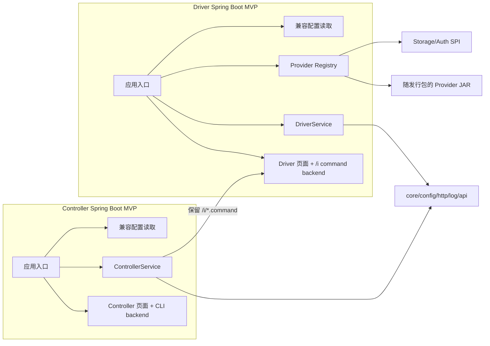

# 方案三 MVP 详细实施方案：收窄重写范围

状态：MVP 范围二次核对稿。重写 Controller、Driver、core、实际依赖闭包及 SineIO/S3；Controller/Driver 页面仍随新应用迁移，但保留 FreeMarker 模板、静态资源、页面结构和 URL，只适配 Web 后端。Mock 仅测试。构建、测试和运行统一以 Java 21 LTS 为基线，应用不再以 Java 17/8 作为运行目标。

相关资料：

- [方案三开发入口](README.md)
- [方案三范围估算](scope-estimate.md)
- [方案三模块与 Provider 盘点](module-inventory.md)
- [方案三兼容性测试与验收矩阵](acceptance-matrix.md)
- [方案三待决策清单](open-decisions.md)

## 1. 目标与边界

### 1.1 目标

在 Java 21 运行时上，把当前 COSBench 变成两个普通 Java 应用：Controller 和 Driver。最终发行包不再依赖 Equinox、OSGi Framework、Spring DM、Tycho、P2 repository 或旧的 Tomcat 6 OSGi bundle，同时保持当前用户能观察到的行为：

- workload XML 的解析、校验、提交、排队、执行、取消、重提和历史归档；
- Controller 到 Driver 的 `/i/*.command` 请求、响应字段、状态码、认证和超时语义；
- Controller 页面/CLI 和 Driver 页面继续提供；保留现有 URL、表单、登录、下载、CSV、Prometheus、FreeMarker 模板和静态资源，改造后端 handler/bean/runtime；
- Driver 接收 Controller 调度的 `/i/*.command` 请求/响应字段、状态码、认证和超时语义；
- mission/workload 的目录结构、日志文件、配置文件和退出行为；
- 本次范围内 SineIO（`sio`、`siov1`、`gdas`）和旧 S3（`s3`）Provider 的名称、配置项、操作行为和错误分类；
- 新 Controller/Driver 进程的启动、停止、健康检查和干净机器上的可复现构建。

### 1.2 非目标

以下内容不进入第一版方案三：

- 不重写 benchmark operation、worker、operator、generator、archive 格式或 HTTP 命令协议；
- 不把 Controller 和 Driver 合并成一个进程；
- 不重新设计页面，不改写 FreeMarker 模板/静态资源，不改变 URL、表单字段和用户流程；仅改造必要的 Java Web backend、Spring wiring、Servlet namespace 和容器配置；
- 不引入新的 REST DTO 层；只保留 Controller 到 Driver 已有 `/i` wire contract；
- 不为了“现代化”同时引入虚拟线程、数据库、微服务、消息队列或新的 workload 语法；
- 不把未纳入本次范围的 Provider 算作新版本已支持；其源码和 OSGi 元数据留在 `legacy/osgi/`，不进入新构建或新发行包。它们的可运行支持只由对应旧版发行包提供。

### 1.3 “相同效果”的判定

“相同效果”不是逐行保留实现，而是对外行为和运行运维习惯保持兼容。内部可以替换 OSGi 服务发现、Spring DM 生命周期和 Tycho 构建，只要 [验收矩阵](acceptance-matrix.md) 中的行为合同不变。

本方案中的“最小改动”指在已确认选择下尽量不重写业务逻辑。Jakarta、标准 Maven 目录、新 YAML 和新命令是已选择的目标，会增加 Web/配置/路径层面的改动；因此这不是所有可选技术路线中的绝对最小 diff。

本 MVP 的行为基线是 Controller、Driver、core、两侧 Web backend、SineIO（`sio`、`siov1`、`gdas`）和旧 S3（`s3`）。保留现有 MVC handler/路由合同及模板输出；Java backend 迁到 Spring Boot 3/Spring 6/Jakarta，旧 XML Bean/FreeMarker 能复用的继续复用。Mock 只在测试 classpath。其余 Provider、Manta、ext 和旧 Tomcat 归档到 `legacy/osgi/`，由旧版发行包继续运行。

## 2. 最小改动原则

1. **保留包名和业务模块边界。** Controller、Driver、core、两侧 Web backend 和实际依赖闭包整理到标准 Maven 目录；不重命名包或合并业务模块。页面模板/资源按路径复用。
2. **保留核心接口。** 继续使用 `ControllerService`、`DriverService`、`StorageAPIFactory`、`AuthAPIFactory`、`StorageAPI`、`AuthAPI` 和现有 model/protocol 类型。先替换装配方式，再讨论接口收敛。
3. **保留 Spring 的有用部分。** 两个 app 使用 Spring Boot 3 + Spring Framework 6/Jakarta，继续复用可迁移的 XML Bean 和 FreeMarker。页面 handler、视图 resolver、filter、上传/下载和 `/i` 命令仍由现有 Web 模块职责承载；移除 Spring DM/OSGi wiring。
4. **Provider 在启动时发现。** 使用静态 `ServiceLoader`；新增或删除 Provider 需要重新打包并重启，不支持运行期热安装/卸载。SineIO/S3 的 SDK 冲突先通过依赖树和 Provider smoke 暴露，再决定是否采用静态的 Provider 依赖隔离目录。
5. **标准化目录和命令。** 最终源码迁移到 `src/main/java`、`src/main/resources`、`src/test/java`，配置统一为新格式，启动/停止使用新命令。迁移期可保留旧脚本作为包装器，但旧入口不是最终合同。
6. **先扩展、后收缩。** 每个阶段先让新装配与旧行为并存并可回退，再删除对应 OSGi 元数据。回退依赖上一版归档和 Git tag，不在新版本中长期维护两套运行时。
7. **不把依赖冲突隐藏。** 共享 classpath 或 Provider classloader 的依赖树、重复类、许可证和 native/JNA 依赖必须可检查；不能只靠 shade 或覆盖 JAR 顺序让构建暂时通过。

### Web 后端接法

| 方案 | 结构与改动 | 评价 |
|---|---|---|
| A. 同进程装配（推荐） | 每个 Boot app 同时装配对应 core service 与现有 Web backend 模块；Controller Web 直接注入 `ControllerService`，Driver Web 直接注入 `DriverService`。保留 FreeMarker 页面、资源、路由和表单；迁移 Java backend 的 `javax.servlet`/Spring API、XML context 和 filter 配置。 | 改动最少；没有新 REST DTO/client；页面渲染仍是本地调用。 |
| B. Web 独立进程 | Controller/Driver 页面继续作为独立 Boot 应用，通过新版本化 HTTP API 访问引擎；FreeMarker 模板可复用，但 Java controller 改为 HTTP client + view model。 | 生命周期隔离清楚，但新增两组 API/client/DTO、认证和错误映射；不符合本轮最小改动优先级。 |
| C. 保留旧 OSGi Web | 新后端与旧 Equinox/Web 通过桥接服务或 HTTP 互通。 | 短期可避免迁模板/部署配置，但双运行时和跨边界桥接增加复杂度，不作为 MVP 默认架构。 |

MVP 推荐 A：UI 类仍需迁移到 Jakarta/Spring 6，但迁移对象是 backend adapter，不是前端重做。视图名称、FreeMarker 模板、静态资源、URL、表单字段和响应内容通过验收矩阵锁定。

## 3. 目标结构

目标结构只增加两个薄的 Spring Boot executable/composition-root 模块：`cosbench-controller-app` 和 `cosbench-driver-app`。新 reactor 包含 Controller、Driver、core、两个 Web backend 模块、必要基础模块、SineIO/S3；Mock 限 test profile。两个 app 分别装配现有页面 handler 和业务 service，优先保留可迁移的 XML wiring 与 FreeMarker 配置，不引入额外 UI API。

`cosbench-controller-web`、`cosbench-driver-web` 和 `cosbench-core-web` 保留为普通 Maven Web backend 模块，迁移 Java source/resources 到标准 layout；FreeMarker 模板、静态资源和路由映射尽量原样保留。`cosbench-tomcat` 不进入新 reactor，其 OSGi loader/register 移入 `legacy/osgi/runtime/`；Boot embedded server 负责两侧 Web 生命周期。

## 4. 分阶段路线

每个迁移批次结束都必须满足其范围内“能构建、能验证、能回退”的条件。下列阶段描述交付范围，实际顺序按[执行索引](../../../.scratch/scheme3-migration/README.md)的依赖图：先完成基线、最小工具链及配置/Provider/Web/HTTP 四项验证，再扩大源码迁移。阶段 1 的完整闭包随阶段 2–4 的模块批次逐步形成；不要求影子构建第一票就迁完全部模块。

### 阶段 0：冻结基线和行为合同

**目的：** 在改构建之前证明现有版本的行为，并把迁移后的检查变成可重复命令。

**工作：**

- 固定当前 SineIO 发行版版本、JDK、OS、Docker 镜像、启动参数和 Provider 组合；
- 为 Mock/noop、SineIO 和 S3 各准备最小 workload，记录提交、启动、查询、取消、归档、日志和 Prometheus 结果；
- 对 Controller 的 `/cli/*.action`、Driver 的 `/i/*.command` 录制请求/响应样例；
- 导出现有配置项、默认值、目录和退出码，区分缺默认文件、缺显式配置、空配置、缺必需字段及非法值；
- 固定迁移版性能/资源画像的硬件/容器限制、workload 和采样方法；旧版性能记录仅供历史参考，不把其阈值用作回归标准；
- 建立 Provider 名称、能力、依赖、许可证和验证状态表；
- 建立旧发行包回退演练：停止新进程后，旧归档和配置可以由上一版完整启动。

**完成条件：** [验收矩阵](acceptance-matrix.md) 的基线列有样例或明确的不可用原因；至少有一个可在 CI/容器中执行的 Mock 端到端命令。

### 阶段 1：普通 Maven 影子构建

**目的：** 把 OSGi manifest 中隐含的依赖显式化，同时尽量不改 Java 代码。

**工作：**

1. 先建立独立普通 Maven 影子 parent/reactor，只验证一个代表性基础模块的标准 layout、资源及 Java 21/release=21；加入固定的 Boot 3.x BOM、toolchain、插件及 Docker/MinIO harness。旧构建用阶段 0 的固定 checkout/归档继续重现。根入口切换及旧 Tycho/P2 删除留到阶段 6。
2. 前置四项验证通过后，按公共基础、Controller、Driver/Mock、各生产 Provider、两侧 Web 的所属票扩展影子 reactor；迁入模块每批独立验证。最终 root reactor 收敛到约 14 个现有模块和两个 app，Mock 限测试；非目标源码在最终收缩移到 legacy，始终不参与新构建。
3. 将活跃模块的 Java 源码、测试、`META-INF`、Web 模板和静态资源整理到标准 Maven 目录；只做机械移动和路径更新，不重命名包或改写业务类。
4. 新 reactor 候选为 `api`、`castor`、`config`、`controller`、`controller-web`、`core`、`core-web`、`driver`、`driver-web`、`http`、`log`、`log4j`、`s3`、`sineio` 和两个 app；Mock 仅 test profile。依赖树/编译确认后可移除无活跃消费者的模块，或把纯日志配置收敛成普通 Maven dependency。
5. 只从活跃模块的 manifest、P2 输入和 `Bundle-ClassPath` 生成候选 Maven 依赖；非目标 Provider、Manta、ext 和旧 Tomcat 在收缩票归档，不转换其 POM、依赖或 OSGi 元数据。
6. 活跃模块当前嵌入的依赖逐项分为公共 Maven 坐标、必须本地保留的依赖，以及 SineIO/S3 需要隔离或验证的依赖。未纳入 Provider 的依赖不进入新发行版分析范围。
7. 活跃模块的 manifest 和 `build.properties` 仅作为迁移参考；新 Maven 构建不读取它们，验收后删除。legacy 目录中的元数据保留，且不纳入“活跃源码无 OSGi”扫描范围。

**完成条件：** 各批次以空缓存 `clean verify` 验证已迁入模块；当应用/Web/Provider 批次全部完成时，影子 reactor 覆盖完整活跃闭包，Mock 只测试可见，新构建不引用 legacy 或 Equinox。CI 在公共模块批次后持续阻断依赖、重复类、jdeps 和许可证错误；阶段 6 将已验证 reactor 提升为根入口。旧 OSGi 归档独立保留。

### 阶段 2：替换 Controller/Driver 组合根

**目的：** 用 Spring Boot 应用入口和普通 Spring 依赖注入替换 Spring DM/OSGi 服务生命周期，保持核心业务代码。

**工作：**

- 新增 `cosbench-controller-app` 和 `cosbench-driver-app` 两个 Spring Boot 模块，分别提供 `main`、新配置解析、日志初始化、shutdown hook、端口和进程退出码；
- 保留 `COSBControllerServiceFactory`、`COSBDriverServiceFactory` 的配置语义。必要时增加显式构造器，但不要把 workload/mission 逻辑搬到 app 模块；
- Controller 组合根创建 `ControllerService`，把它作为同一 Spring context 的 `controller` bean，供 Controller Web backend 注入；
- Driver 组合根创建 Provider registry、`COSBAuthAPIService`、`COSBStorageAPIService` 和 `DriverService`，把它作为同一 Spring context 的 `driver` bean，供 Driver Web backend 和 `/i` handlers 注入；
- 将 `controller-context.xml`、`driver-context.xml` 改为普通 bean 定义；删除 `controller-osgi-context.xml`、`driver-osgi-context.xml` 中的 OSGi service/list；Spring DM、OSGi Framework、Equinox、Tycho/P2 和旧 Tomcat 6 不再是方案三运行时或构建依赖；
- 将 `COSBControllerService`、`COSBDriverService` 中的 `System.exit(-1)` 改为启动阶段抛出可诊断异常，由 app 入口统一设置退出码；业务线程不直接退出进程；
- 将 `dev/cosbench-log` 的 `Activator.start/stop` 逻辑移入应用生命周期，保留 `LogManager.dispose()` 的显式关闭；
- 不在此阶段修改 Controller 到 Driver 的 tasklet、protocol response 或 retry 实现。

**完成条件：** Controller 和 Driver 可以分别由普通 Java 进程启动；Mock workload 完成一条提交、登录、执行、查询、关闭链路；进程收到 TERM 后停止 HTTP server、线程池、Provider client 和日志系统。

### 阶段 3：替换 Web 运行时但保留页面和路由

**目的：** 移除 OSGi Web extender 和旧 Tomcat bundle，使用 Spring Boot 3 + Jakarta embedded web runtime，保留现有 Web 行为。默认直接使用 Spring Boot 管理的 embedded Tomcat 10.1；不再单独打包或维护 `cosbench-tomcat`。

**默认实现：** 保留 46 个 FreeMarker 模板/静态资源、页面结构、视图名称、路由和表单合同；不做前端重新设计。迁移 47 个 Controller/Driver Web Java backend 类和 3 个 `core-web` 类中必要的 Servlet/Spring 接口，使用 Spring Boot 3 embedded container。先复用 Spring MVC XML 和 FreeMarker 配置，通过同一 application context 注入 `controller`/`driver` bean；只有 Boot 3 不兼容的旧 handler/filter/context bootstrap 才在 backend adapter 层改写。Boot 3 的具体受支持小版本在实施时锁定，并用官方系统要求和 Servlet 容器矩阵复核。

**工作：**

1. `controller-web-osgi-context.xml` 和 `driver-web-osgi-context.xml` 删除 OSGi 引用，由 Boot app 中的普通 Spring context 提供同名 bean。
2. 保留现有页面 handler、view name、route、filter 和表单字段；替换 `OsgiBundleXmlWebApplicationContext`、旧 Web extender 和不可复用的启动配置。两个 DispatcherServlet 可以继续分开注册。
3. `WEB-INF/web.xml` 中的 servlet/filter/security/welcome/MIME 行为逐项保留；将旧 OSGi context bootstrap 改为 Boot servlet initializer 或普通 XML bean registration。是否保留整个 web.xml 由容器 spike 结果决定。
4. `controller-web`、`driver-web`、`core-web` 转成普通 Maven Web backend JAR；FreeMarker 模板/静态资源直接复用，只有资源加载路径在 Boot classpath 下失效时才调整路径。
5. 将所需的 `javax.servlet` backend import 迁到 `jakarta.servlet`，统一 Jakarta Servlet、Spring Framework 6 和 Spring Boot 3 依赖。页面 controller 尽可能保留旧 Spring MVC API；不能兼容的部分只改 adapter/配置，不重写页面行为。
6. 删除 `cosbench-tomcat` OSGi loader/register；由 Spring Boot embedded container 管理两侧页面与 Driver 命令接口生命周期。

**完成条件：** 页面 URL、表单、FreeMarker 输出、静态资源、下载、CSV、Prometheus、Controller `/cli/*.action` 和 Driver `/i/*.command` 通过 [Web/命令矩阵](acceptance-matrix.md)；两侧 UI 和 Driver protocol endpoint 在新进程中同时可用。对比旧版 HTML/CSV 样例，确认没有因模板变量或 model attribute 变化导致视图破坏。

### 阶段 4：Provider SPI 和隔离

**目的：** 用静态 `ServiceLoader` 替换 `<osgi:service>`，只迁移 SineIO、S3 和测试用 Mock Provider。

**公共 SPI：**

- 保持 `StorageAPIFactory#getStorageName/getStorageAPI` 和 `AuthAPIFactory#getAuthName/getAuthAPI`；
- 新增 `META-INF/services/com.intel.cosbench.api.storage.StorageAPIFactory` 和 `META-INF/services/com.intel.cosbench.api.auth.AuthAPIFactory`；
- 新增 `StorageFactoryRegistry`、`AuthFactoryRegistry`，负责发现、名称唯一性、排序、缺依赖诊断和按名称查找；
- `COSBStorageAPIService`/`COSBAuthAPIService` 继续只依赖 `List<...Factory>`，业务代码不直接调用 `ServiceLoader`。

**Provider 装载顺序：**

1. 在测试 classpath 放入 Mock、在生产 classpath 放入 SineIO 三个 factory 和 S3 factory，完成 registry/端到端链路；
2. SineIO 的 `sio`、`siov1`、`gdas` 必须全部登记，不能只迁移默认 `sio`；
3. S3 先保留当前旧 AWS SDK 调用和配置语义，依赖冲突通过依赖树和 smoke 暴露，不与 SDK 升级混批；
4. 其它 Provider、Manta、`ext/adaptor` 和旧 Tomcat 源码移动到 `legacy/osgi/`；新 reactor 和发行包不引用它们。旧版归档是这些 Provider 的唯一可运行支持渠道。

**依赖处理：**

- 默认由应用 classloader 上的 `ServiceLoader` 在启动时发现随应用发布的 SineIO 和 S3 factory；Mock 仅在测试中发现；
- 先验证 SineIO 与 S3 能否在同一 classpath 共存；只有 smoke 证明有冲突时，才增加随应用发布的静态 Provider 目录和启动时 child classloader。该隔离仍由 `ServiceLoader` 启动时装载，不支持外部热安装/热卸载；
- Provider registry 只向业务暴露 `StorageAPIFactory`/`AuthAPIFactory`，不把 SDK 类型泄漏到 SPI；
- 关闭时调用 Provider 返回的 storage/auth `dispose`，确保 HTTP client、线程和 native 资源释放。

**完成条件：** 每个纳入范围的 factory 能被 registry 发现且名称唯一；缺依赖、重复名称和初始化失败都能指出 Provider 名称；至少每类 Provider 有一个配置校验和 smoke workload；不纳入范围的 Provider 不会被错误地宣称已支持。

### 阶段 5：配置、启动和发布兼容

**目的：** 采用统一的新配置和新命令，同时保留迁移期转换工具，并从新发行物中移除 Equinox/P2 产物。

**工作：**

- 新增统一且版本化的 `conf/controller.yml`、`conf/driver.yml`，明确端口、archive/mission 目录、Driver 列表、日志、Provider 和 Web 设置；迁移工具负责把旧 INI 转换成 YAML，并在转换报告中列出不能自动映射的值；
- 新增 `bin/cosbench-controller`、`bin/cosbench-driver`、`bin/cosbench-stop` 和 `bin/cosbench-config-migrate` 命令，分别启动应用、停止进程和转换旧配置；新命令是最终入口，是否提供旧脚本薄包装器由发布兼容测试决定；
- 新 stop 命令通过 PID/进程组和 health endpoint 管理生命周期；停止成功的定义是 HTTP 端口释放、线程池结束、Provider client 关闭；
- `dev/cosbench-dev.sh` 改为新命令和 Java 21 toolchain，保留 `start/stop/restart/controller/driver/all` 作为开发体验参数；
- `pack.sh`/`pack-sineio.sh` 从复制 `dist/osgi` 改为复制两个 app、运行依赖、conf、workloads、bin、脚本和许可证；Mock 不打入生产归档；
- Dockerfile 和 CI 从 Java 8/Equinox 镜像改为 Java 21 runtime，并在镜像内执行普通 Java health check；
- `BUILD*.md`、适配器开发指南和 README 写明 SPI、Provider 目录、重启要求、配置兼容期和回退步骤；
- 保留上一版本归档作为回退制品。新版本不删除旧 workload/archive；配置迁移工具必须可逆或能保留原文件。

**完成条件：** 空目录安装、旧 INI 转换到新 YAML、使用新命令启动 Controller/Driver、测试 classpath 上运行 Mock 流程、发布包中运行 SineIO/S3 smoke、停止、重启恢复历史、打包和 Docker smoke 全部通过；新发行物不生成 `dist/osgi`、`config.ini`、P2 repository 或 Equinox console 配置。

### 阶段 6：收缩和最终清理

只有阶段 0 到 5 的验收条件完成、迁移版性能/资源画像已记录后才执行活跃模块清理：

- 将已验证的普通 Maven reactor 提升为根入口，移除根 Tycho extension/P2 配置；清理后重建生产制品并复验相关构建、运行和回退合同；
- 删除活跃模块的 OSGi manifest 和仅服务于 PDE 的 `build.properties`；
- 删除活跃模块中的 `*-osgi-context.xml` 和 SineIO/S3 `plugin-context.xml` OSGi service/reference；
- 删除 `org.osgi.*` 运行依赖、Equinox launcher、Spring DM、旧 Tomcat 6 bundle、P2 metadata 和 `dist/osgi` 发布逻辑；
- 旧 `cosbench-tomcat` 源码与元数据保存在 `legacy/osgi/runtime/`；Boot app 不再依赖该模块；
- 从活跃运行脚本和部署 runbook 删除旧 `config.ini`/OSGi console 启动依赖；配置迁移文档保留旧格式说明；
- 执行活跃源码、root POM、资源、脚本、Docker、CI 和发行包扫描，确认不要求 OSGi。`legacy/osgi/` 和历史发行包是明确保留的例外，不得被新构建引用；
- 打 tag，保留上一版归档和迁移说明作为回退路径。

## 5. 具体模块改造表

| 模块组 | 当前模块 | 方案三最小改动 | 最终形态 |
|---|---|---|---|
| 公共接口 | `cosbench-api` | 保留接口；增加 SPI service descriptor 和必要的 Provider metadata | 普通 JAR |
| 配置/序列化 | `cosbench-config`、`cosbench-castor` | 把 Fragment/Require-Bundle 改为 Maven 依赖；保持 XML/INI 语义 | 普通 JAR |
| 核心模型 | `cosbench-core` | 基本不改业务类；显式依赖 commons/Jackson/HTTP | 普通 JAR |
| HTTP 客户端 | `cosbench-http` | 保留 Controller->Driver 客户端和请求格式；显式化 Apache HTTP 依赖 | 普通 JAR |
| 日志 | `cosbench-log`、`cosbench-log4j` | 移除 log Activator/Fragment；应用入口负责初始化和关闭 | 普通 JAR |
| Controller | `cosbench-controller` | 保留 scheduler、tasklet、archive、exporter；移除 Spring/OSGi 生命周期耦合 | 普通 JAR |
| Driver | `cosbench-driver` | 保留 agent/operator/generator/mission 逻辑；接收普通 registry 提供的 factory list | 普通 JAR |
| Controller Web | `cosbench-controller-web` | 保留 6 个 CLI handler、20 个页面/辅助类、21 个模板和静态资源；替换 OSGi context | Web JAR/WAR 资源 |
| Driver Web | `cosbench-driver-web` | 保留 10 个 command handler、11 个页面/辅助类、11 个模板和静态资源；替换 OSGi context | Web JAR/WAR 资源 |
| Web 公共层 | `cosbench-core-web` | 保留 `AbstractController`、异常和 Servlet 适配；按 Web 栈更新依赖 | 普通 JAR |
| Web runtime | `cosbench-tomcat` | 删除 OSGi loader/register；由 Spring Boot embedded container 接管 | Spring Boot app 内部库 |
| Provider | `cosbench-sineio`、`cosbench-s3`、测试用 `cosbench-mock` | SineIO/S3 删除 OSGi service 注册、增加 production SPI；Mock 只在 test profile 增加测试 SPI | production 普通 JAR；Mock 不进发行包 |
| 其它 Provider | 其余 13 个根 Provider | 源码和 OSGi 元数据移动到 `legacy/osgi/providers/`；不进新 reactor/发行包 | 只有旧版归档可运行 |
| Manta/ext | `dev/cosbench-manta`、`ext/adaptor/*` | 源码和 OSGi 元数据移动到 `legacy/osgi/providers/`；不转换 POM 或 SPI | 只有旧版归档可运行 |
| 旧 Web runtime | `cosbench-tomcat` | 移动到 `legacy/osgi/runtime/`；Boot embedded server 接管新应用 | 只有旧版归档可运行 |
| 应用入口 | 新增 `cosbench-controller-app`、`cosbench-driver-app` | 只放 main、配置、日志、Web runtime、shutdown hook 和组合根 | executable JAR |

## 6. 依赖迁移规则

当前根 POM 的模块几乎没有 Maven dependency declarations，依赖主要藏在 manifest/P2 和各 Provider 的 `Bundle-ClassPath` 中。因此普通 Maven 化不能只把 `eclipse-plugin` 改成 `jar`。按以下顺序处理：

1. **内部模块依赖。** 根据 Import/Export package 和源码 import 生成候选图，再通过编译确认。公共依赖方向应为 `api <- core <- controller/driver <- app`；Provider 只依赖 `api/config/log/http` 等已声明接口。
2. **公共第三方依赖。** 对 commons、Spring、Servlet、FreeMarker、Apache HTTP、Jackson、CSV、Castor 等在 parent dependency management 中固定一个版本，并为需要旧 API 的模块显式声明。
3. **旧 Jackson。** Controller/Driver 的 `/i` 协议当前使用 `org.codehaus.jackson` 1.x。第一版先把该依赖作为兼容组件显式化；只有契约测试固定后，才单独规划 Jackson 迁移。
4. **Provider SDK。** 只审计 S3/SineIO 所需 AWS SDK、Jackson、HTTP client 等依赖；保持现有调用和配置，不在本次顺便升级 SDK。其他 Provider 的 SDK 留在 `legacy/osgi/`，不进入新 classpath。
5. **本地 JAR。** 当前 173 个 module-local JAR、其中 167 个来自 Provider 目录是全仓现状；本次只处理活跃依赖闭包内的 JAR。可从公共仓库取得的依赖转为 Maven 坐标；其余按许可证、校验和纳入 SineIO/S3 的发布清单。
6. **重复类。** 对新 app + SineIO/S3 的实际组合运行 dependency convergence、duplicate classes、`jdeps` 和容器启动检查。只在真实冲突时增加静态 Provider classloader，不为 legacy Provider 预先搭建隔离层。
7. **构建 JDK 与目标字节码。** 构建、测试和运行统一使用 Java 21 LTS，并统一 `maven.compiler.release=21`。不再为 Java 17/8 保留新的发行版 bytecode 目标；旧 Java 8 目标只存在于 legacy 归档。

### 6.1 Spring Boot 3 后的依赖升级与替代清单

| 现有技术/包 | 方案三处理 | 目标/候选包 | 说明 |
|---|---|---|---|
| Equinox、OSGi Framework、`org.osgi.*` | 必须移除 | 无替代运行时；普通 Maven module + Spring DI | 新发行版不再有 bundle 生命周期、动态安装或 bundle classloader |
| Spring Dynamic Modules / Spring DM | 必须移除 | Spring Boot 3、Spring Framework 6、Spring Java Config/XML | 只保留普通 Spring Bean，不保留 OSGi service/reference namespace |
| Tycho、P2、PDE metadata | 必须移除 | Maven Compiler/Surefire/Failsafe/Resources、普通 parent/reactor | `MANIFEST.MF`/`build.properties` 仅作为迁移输入，legacy 原样保留 |
| `cosbench-tomcat`、Tomcat 6 bundle | 必须移除 | `spring-boot-starter-web` 管理的 embedded Tomcat 10.1/Servlet 6 | 不再单独打 Tomcat JAR、Catalina OSGi 注册或 Tomcat XML；只有需要时才替换为 Jetty 12 或 Undertow 2.3 |
| `javax.servlet.*` | 必须替换 | `jakarta.servlet.*`、Spring 6 Web MVC | 页面模板不改，Servlet/filter/listener 与 XML schema 改为 Jakarta |
| 旧 Spring MVC 3.x | 必须升级 | Spring Web MVC 6.x（由 Boot BOM 管理） | 保留 handler/view model 行为；无法兼容的旧 API 只在 Web backend 做适配 |
| `org.codehaus.jackson` 1.x | 先兼容、后升级 | Jackson 2.x（`jackson-databind`、`jackson-core`、`jackson-annotations`） | `/i` REST/wire contract 先用兼容测试锁定，再迁移注解、空字段和错误格式；不能直接混用两代 ObjectMapper |
| Apache Commons / Guava 等通用库 | 依赖树确认后升级 | Spring Boot dependency management 中的稳定版本 | 逐个检查 API/序列化/集合行为，不为了版本整齐改业务逻辑 |
| Apache HttpClient 旧版或 `commons-httpclient` | 优先替代 | Java 21 `java.net.http.HttpClient` 或 Apache HttpClient 5.x | Controller→Driver REST client 与 SineIO/S3 SDK 先分开验证连接池、超时、TLS 和代理语义 |
| Jackson XML / JAXB 旧实现 | 可升级 | Jackson XML 2.x 或 Jakarta XML Binding 4.x | workload XML 解析以现有 Castor/配置行为为基线；只有兼容测试通过才替换 Castor |
| Castor XML | 暂不主动替换 | 保留 `cosbench-castor`；候选为 Jackson XML/JAXB | Castor 可能承载旧 XML 映射语义，本 MVP 先保行为，替换作为独立 spike |
| Log4j 旧 bundle/Activator | 改为普通依赖 | `spring-boot-starter-logging`（SLF4J + Logback）或 Log4j2 starter | 推荐先用 Boot 默认 Logback；若必须保留 Log4j2，使用 Boot 管理的 `log4j-api/core`，移除 OSGi Activator |
| FreeMarker 旧 Web bundle | 保留模板，升级运行库 | `spring-boot-starter-freemarker` | 只升级模板引擎装配和资源路径；页面文件、视图名和输出合同不重写 |
| 旧 multipart/文件上传实现 | 升级 | Spring MVC multipart + embedded container limits | 保留上传大小、临时目录、下载权限和错误语义，增加边界测试 |
| 旧 Prometheus servlet/exporter | 依赖审计后替换 | Micrometer + `micrometer-registry-prometheus`、Actuator | 指标名称、标签和输出兼容优先；不能因引入 Actuator 自动改变已有指标 |
| AWS SDK 旧版（S3） | 本 MVP 先保持调用，单独验证后升级 | AWS SDK for Java 2.x | SDK 迁移涉及签名、path-style、region、重试和异常映射，不与 OSGi 移除混批 |
| SineIO SDK/本地 JAR | 先显式 Maven 化 | 官方/供应方 Maven 坐标；无坐标则保留带 checksum/license 的本地依赖 | 只处理 SineIO 活跃依赖闭包，其他 Provider SDK 留在 legacy |
| 本地嵌入 HTTP/JSON/JAR | 逐项替换 | Maven Central 坐标或供应方坐标 | 通过 `dependency:tree`、重复类扫描、许可证和真实 smoke 决定，不能仅按文件名替换 |

升级顺序固定为：先移除 OSGi/Spring DM/Tycho/P2 与 Tomcat 6，再完成 Servlet/Jackson/Spring 兼容；然后分别评估日志、HTTP client、监控和 Provider SDK。任何 SDK 大版本升级都必须有独立回归矩阵。

## 7. 回退与发布策略

### 回退点

- 阶段 0：旧发行包原样回退；
- 阶段 1：旧 Tycho 构建提交/Tag 可重新构建；
- 阶段 2：Controller/Driver 仍可使用旧发行包，配置和 archive 目录不变；
- 阶段 3：新 Web runtime 失败时回退到上一版完整归档，不能只替换单个 JAR；
- 阶段 4：SineIO/S3 smoke 失败时回退上一版完整发行归档；不把 legacy Provider 临时塞入新 classpath 作为回退；
- 阶段 5/6：发布包带版本化 app/lib/plugins/conf，旧版本目录保留到迁移窗口结束。

### 不可逆操作闸门

执行以下操作前必须有独立验收记录：

- 删除 `dist/osgi`、P2 repository 或旧 launcher；
- 删除/重命名 archive/workspace/config 目录；
- 修改 CLI 和 `/i` 路由、响应字段或认证；
- 升级 Provider SDK 导致配置、签名、TLS 或错误映射变化；
- 将 `javax.servlet` 迁到 Jakarta；
- 对外发布新支持范围与 legacy Provider 列表；旧版归档是 legacy 能力的唯一可运行支持。

## 8. 预计改造量和人力边界

按已确认范围（Controller、Driver、core、两侧 Web backend、SineIO、S3，Mock 仅用于测试）估算：

- 新增 2 个 app/composition-root 模块；若把 registry 独立成模块，增加第 3 个模块；
- 根 reactor 候选为 14 个现有模块加两个 app 模块；依赖闭包确认后才锁定精确数量。Mock 仅属于 test profile，不在 production reactor/package 中；
- 活跃模块的 manifest 和 `build.properties` 删除或由 Maven 配置取代；legacy 的 13 个根 Provider、Manta、ext 和旧 Tomcat 的 OSGi 元数据保留；
- SineIO、S3 增加正式 SPI descriptor；Mock 的 descriptor 只由测试构建打包；
- 47 个 Controller/Driver Web Java 类和 3 个 core-web 类需要重编译并验证，默认不逐个重写业务逻辑；
- 13 个不迁移的根 Provider、Manta 和 ext 合计约 107 个 Java 源文件、约 304 条已跟踪路径移入 `legacy/osgi/`；这是目录归档，不是代码改写。旧 Tomcat 另行归档；
- 新增约 25~45 个测试类，重点是 registry、配置转换、HTTP contract、Web smoke、生命周期和 Provider contract；
- 活跃代码、构建、配置和发布的内容改动预计约 190~300 个文件；此外约 450 条活跃源代码/资源路径整理为标准 Maven 目录，约 300 条 legacy 路径改名。Git 可把纯移动识别为 rename；不应把这些路径移动解读成相同数量的代码重写。页面模板/静态资源原则上只做资源路径迁移。

Jakarta/Spring 6 已属于本次确认范围，并由前置 Web 验证控制风险。所有旧 SDK 的大版本升级及外部 Provider 热加载仍需独立立项；不把这些工作混入本次迁移。

## 9. 完成定义

方案三只有在以下条件全部满足时才算完成：

- `mvn clean verify` 从空缓存构建成功，构建过程不调用 Tycho/P2；
- 新发行包和 Docker 镜像不包含 Equinox、OSGi Framework、Spring DM、旧 Tomcat 6 bundle、Mock Provider 或 `config.ini`；legacy 源码本身可保留 OSGi 元数据；
- Controller/Driver 以 Java 21 普通进程启动、停止、重启，PID、退出码和日志可诊断；
- Web/CLI/`/i/*.command` 路由和行为合同通过；
- SineIO 的 `sio`、`siov1`、`gdas`、S3 的 `s3` 以及测试用 Mock 均由 registry 发现并通过 smoke；
- 非目标 Provider 位于 `legacy/osgi/`、不进入新 reactor/发行包；相应旧版归档仍是唯一受支持的可运行发行物；
- workload、mission、archive、log、config 和 Prometheus 行为与基线一致；
- 至少完成一次旧版归档/配置回退演练；
- 文档、Docker、CI、开发脚本和适配器指南描述的是同一套普通 Java 运行方式；
- 至少三次同参数迁移版性能/资源画像已记录，功能计数一致且报告运行间波动；不作跨版本性能回归结论。Controller-only、Driver-only、both、多 Driver 组合及命令幂等验收通过。
